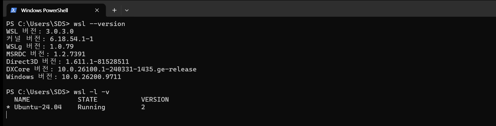
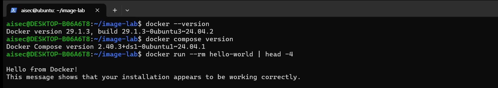
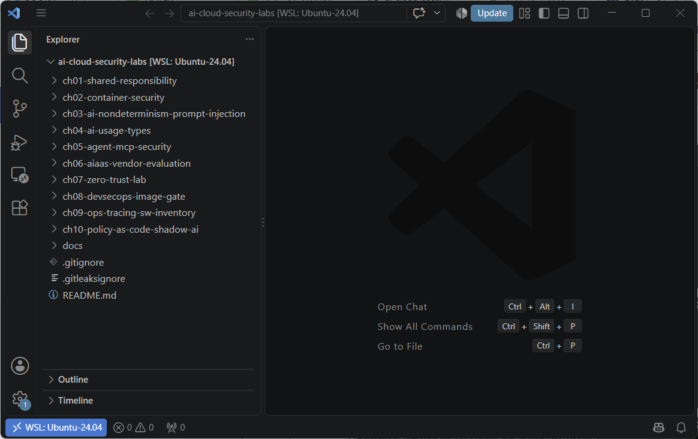
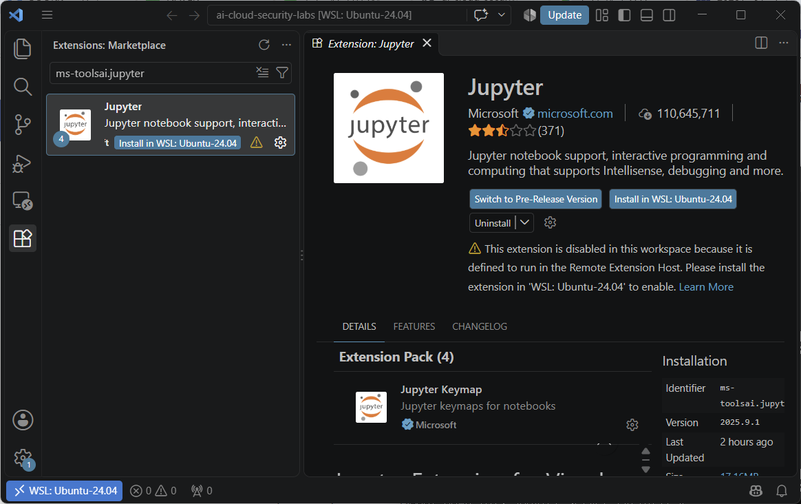
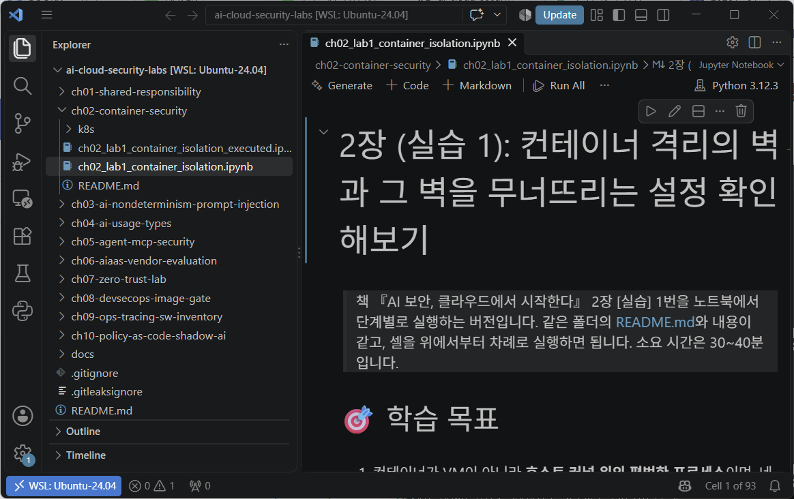
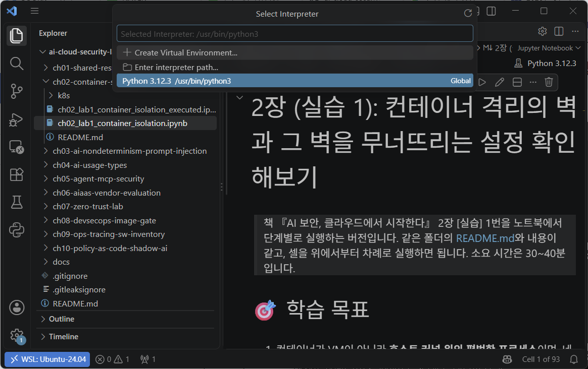
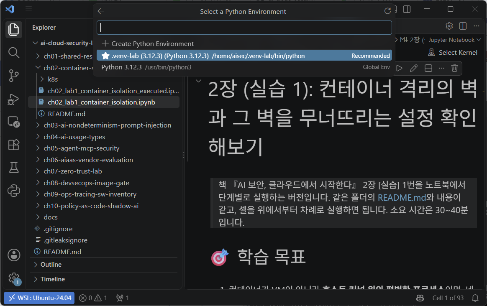
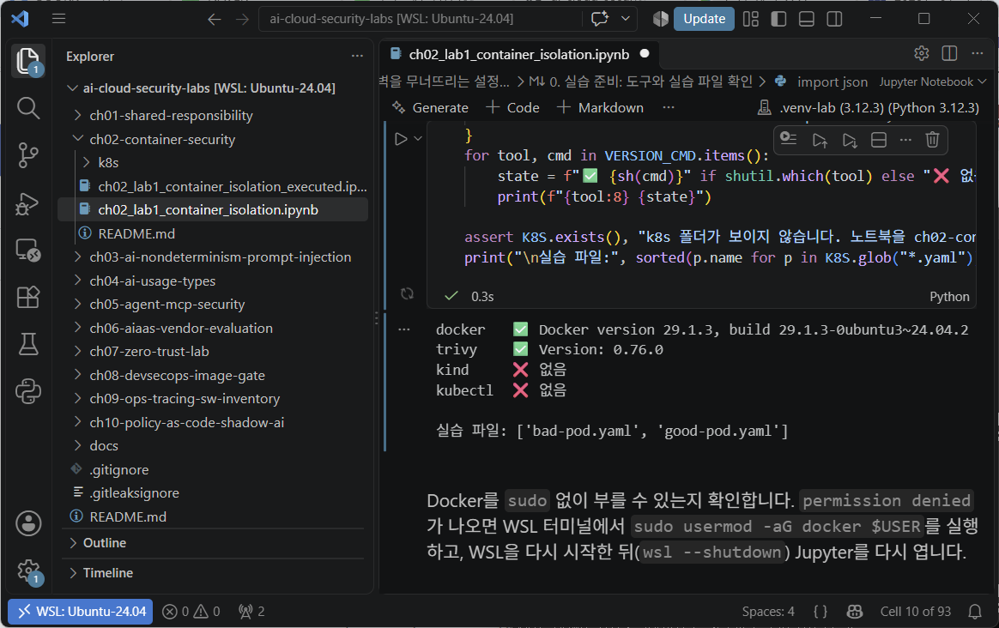

# 실습 환경 준비 (SETUP)

> 책 『AI 보안, 클라우드에서 시작한다』의 코드 실습(2·4~10장)을 하기 전에 **한 번만** 하는 준비입니다. Windows PC에 WSL2로 리눅스·Docker 실습 환경을 만들고, 이 저장소를 내려받고, (선택) VS Code와 Jupyter 노트북을 연결합니다.
> 책 본문에서 "`ch08-devsecops-image-gate`의 [실습 준비]"를 보라고 한 곳도 이 문서를 보면 됩니다.

> 이 책의 코드 실습은 대부분 리눅스(WSL2의 Ubuntu)에서 확인했고, 그중 2장 실습 1, 5장 실습 3, 6장 실습 3, 7장 실습 2, 8장 실습 1·2, 9장 실습 3는 Docker도 필요합니다. 별도의 리눅스 서버가 없어도, Windows PC에 WSL2(Windows Subsystem for Linux)를 켜면 PC 안에서 진짜 리눅스(Ubuntu)를 돌릴 수 있습니다. 소요 시간은 20~30분입니다(내려받기 시간 포함, VS Code 연결은 별도).
> 이 책의 화면은 Windows 11 Pro(10.0.26200), WSL 3.0.3, Ubuntu 24.04, Docker 29.1.3, Trivy 0.76.0에서 실제로 실행해 캡처했습니다.

**이 준비는 한 번만 하면 됩니다.** 여기서 만든 환경을 2~10장의 코드 실습에 그대로 씁니다. 처음이라면 1~5단계를 한 번에 끝내 두세요. 단계마다 **"이렇게 보이면 성공"**을 적어 두었으니, 그 화면을 확인하고 다음 단계로 넘어가면 됩니다. 중간에 막히면 맨 아래 [막혔을 때]부터 보세요.

| 단계 | 하는 일 | 명령을 입력하는 곳 |
|---|---|---|
| 1 | WSL과 Ubuntu 설치 | Windows PowerShell(관리자) |
| 2 | Ubuntu 처음 실행과 사용자 만들기 | Windows PowerShell → Ubuntu 터미널 |
| 3 | Docker 설치 | Ubuntu 터미널 |
| 4 | Trivy 설치 | Ubuntu 터미널 |
| 5 | 실습 저장소 내려받기 | Ubuntu 터미널 |
| 6 | (선택) VS Code와 Jupyter 노트북 연결 | Windows와 Ubuntu 터미널 |

## 시작하기 전에. 명령 창 두 가지를 구분하기

이 문서에는 명령 창이 두 가지 나옵니다. 명령이 안 될 때 가장 흔한 원인은 **창을 잘못 고른 것**입니다.

| 창 | 프롬프트 모양 | 이 문서의 코드 블록 |
|---|---|---|
| Windows PowerShell | `PS C:\Users\홍길동>` | `powershell`이라고 적힌 블록 |
| Ubuntu 터미널 | `aisec@PC이름:~$` | `bash`라고 적힌 블록 |

- 명령은 한 줄씩 복사해 붙여 넣고 Enter를 누릅니다. Ubuntu 터미널에서는 **마우스 오른쪽 버튼**(또는 Ctrl+Shift+V)으로 붙여 넣습니다.
- `#` 뒤의 글은 설명(주석)입니다. 같이 붙여 넣어도 실행에는 영향이 없습니다.
- `sudo`가 붙은 명령은 처음 실행할 때 비밀번호를 묻습니다. 2단계에서 만든 **Ubuntu 비밀번호**를 넣습니다(Windows 비밀번호가 아닙니다). 입력해도 화면에 아무것도 표시되지 않는 것이 정상입니다.

## 1단계. WSL과 Ubuntu 설치

시작 메뉴에서 **Windows PowerShell을 마우스 오른쪽 버튼으로 눌러 "관리자 권한으로 실행"** 한 뒤 다음 명령을 입력합니다.

```powershell
wsl --install -d Ubuntu-24.04
```

```text
다운로드 중: Ubuntu 24.04 LTS
설치 중: Ubuntu 24.04 LTS
배포가 설치되었습니다. 'wsl.exe -d Ubuntu-24.04'을(를) 통해 시작할 수 있습니다.
```

- WSL을 처음 켜는 PC라면 "가상 머신 플랫폼" 기능이 함께 켜지고, **재부팅을 요구**할 수 있습니다. 재부팅한 뒤 같은 명령을 한 번 더 실행합니다.
- 회사 PC에서 설치가 막혀 있다면 BIOS의 가상화(Intel VT-x, AMD-V) 설정이나 회사 보안 정책 때문일 수 있습니다. 실습용 PC를 쓰거나 IT 부서에 문의합니다.

설치가 끝나면 버전과 상태를 확인합니다.

```powershell
wsl --version
wsl -l -v
```

**이렇게 보이면 성공**: `wsl -l -v`의 목록에 `Ubuntu-24.04`가 있고, `VERSION`이 **2**입니다. 1이면 Docker가 동작하지 않으므로 [막혔을 때]를 봅니다.



*[화면 준비-1] WSL 설치 확인*

## 2단계. Ubuntu 처음 실행과 사용자 만들기

```powershell
wsl -d Ubuntu-24.04
```

처음 실행하면 리눅스에서 쓸 사용자 이름과 비밀번호를 묻습니다. Windows 계정과 달라도 됩니다. 이 책의 화면은 `aisec`이라는 사용자로 진행했습니다. 사용자 이름은 영어 소문자로 짓고, 비밀번호는 `sudo`를 쓸 때마다 필요하니 꼭 기억해 둡니다. 비밀번호는 입력해도 화면에 표시되지 않습니다.

```text
Create a default Unix user account: aisec
New password:
Retype new password:
```

**이렇게 보이면 성공**: 프롬프트가 `aisec@PC이름:~$`처럼 바뀝니다.

이제부터의 명령은 모두 이 Ubuntu 터미널에서 실행합니다. 다음에 다시 열 때는 시작 메뉴의 **"Ubuntu 24.04"**를 누르거나, Windows Terminal의 탭 목록(제목 줄의 ∨ 단추)에서 고릅니다.

## 3단계. Docker 설치

Ubuntu 공식 저장소의 Docker 엔진을 설치하고, 매번 `sudo`를 붙이지 않도록 사용자를 `docker` 그룹에 넣습니다.

```bash
sudo apt update
sudo apt install -y docker.io docker-compose-v2 docker-buildx
sudo usermod -aG docker $USER
exit                     # 그룹 변경을 반영하려고 한 번 나갔다가
```

```powershell
wsl -d Ubuntu-24.04      # 다시 들어옵니다
```

```bash
docker --version
docker compose version
docker run --rm hello-world | head -4
```

**이렇게 보이면 성공**: Docker와 Docker Compose의 버전이 나오고(이 책에서는 29.1.3과 2.40.3), hello-world 컨테이너가 `Hello from Docker!`를 출력합니다.



*[화면 준비-2] Docker 동작 확인*

> Ubuntu 24.04의 WSL은 systemd가 기본으로 켜져 있어 Docker가 자동으로 시작됩니다. `Cannot connect to the Docker daemon` 오류가 나오면 `sudo systemctl start docker`로 직접 시작합니다.
> `permission denied ... docker.sock` 오류가 나오면 그룹 변경이 아직 반영되지 않은 것입니다. PowerShell에서 `wsl --shutdown`을 실행한 뒤 Ubuntu를 다시 엽니다.
> WSL은 열려 있는 터미널이 하나도 없으면 잠시 뒤 리눅스를 내립니다. 실습 중 컨테이너를 띄워 둘 때는 Ubuntu 터미널을 하나 열어 둡니다.

## 4단계. Trivy 설치 (공식 저장소와 서명 키로)

5-2에서 본 것처럼 2026년 3월 Trivy의 배포 과정이 침해된 적이 있습니다. 보안 도구도 공급망 공격의 대상이므로, **공식 저장소를 서명 키와 함께 등록해** 설치하고 버전을 기록합니다. 아래 명령은 줄 끝의 `\`로 이어진 한 명령도 있으니, 블록 전체를 한 번에 복사해 붙여 넣어도 됩니다.

```bash
sudo apt install -y wget gnupg
wget -qO - https://aquasecurity.github.io/trivy-repo/deb/public.key \
  | gpg --dearmor | sudo tee /usr/share/keyrings/trivy.gpg > /dev/null
echo "deb [signed-by=/usr/share/keyrings/trivy.gpg] https://aquasecurity.github.io/trivy-repo/deb generic main" \
  | sudo tee /etc/apt/sources.list.d/trivy.list
sudo apt update && sudo apt install -y trivy
trivy --version
```

**이렇게 보이면 성공**: `Version: 0.76.0`처럼 Trivy의 버전이 나옵니다(설치 시점에 따라 더 높을 수 있습니다).

`signed-by`로 지정한 키로 서명된 패키지만 설치되므로, 누군가 중간에서 패키지를 바꿔치기해도 설치가 거부됩니다. 설치한 버전은 실습 기록에 남겨 둡니다. 나중에 해당 버전에 문제가 알려졌을 때 영향 여부를 바로 확인할 수 있습니다.

## 5단계. 실습 저장소 내려받기

이 저장소를 Ubuntu의 홈 디렉터리로 내려받습니다. Ubuntu 24.04에는 `git`이 처음부터 들어 있습니다.

```bash
cd ~
git clone https://github.com/cloudsec-0101/ai-cloud-security-labs.git
ls ~/ai-cloud-security-labs
```

```text
README.md                                ch06-aiaas-vendor-evaluation
ch01-shared-responsibility               ch07-zero-trust-lab
ch02-container-security                  ch08-devsecops-image-gate
ch03-ai-nondeterminism-prompt-injection  ch09-ops-tracing-sw-inventory
ch04-ai-usage-types                      ch10-policy-as-code-shadow-ai
ch05-agent-mcp-security                  docs
```

**이렇게 보이면 성공**: `ch01-...`부터 `ch10-...`까지 장별 폴더가 보입니다. 이제 각 장 README에 나오는 `~/ai-cloud-security-labs`가 바로 이 폴더입니다.

- 각 장의 실습은 이 폴더에서 필요한 파일을 홈 디렉터리의 작업 폴더(예: `~/pod-lab`)로 **복사해서** 진행합니다. 실습하다 파일을 망가뜨려도 원본은 그대로이니, 작업 폴더를 지우고 다시 복사하면 처음부터 할 수 있습니다.
- Windows 폴더(`/mnt/c`, `/mnt/d`)가 아니라 리눅스 홈에 두는 이유는 속도입니다. Windows 폴더에서 작업하면 이미지 빌드와 파일 처리가 훨씬 느립니다.
- 저장소가 고쳐졌을 때는 `cd ~/ai-cloud-security-labs && git pull`로 새 내용을 받습니다.
- Windows 탐색기로 이 폴더를 보고 싶으면 `cd ~/ai-cloud-security-labs && explorer.exe .`를 실행합니다.

## 6단계. (선택) VS Code와 Jupyter 노트북 연결

README를 보며 Ubuntu 터미널에 명령을 입력해 실습한다면 이 단계는 건너뛰어도 됩니다. 코드 실습을 **Jupyter 노트북**(`chNN_labN_...ipynb`)으로 셀 단위로 실행하거나, VS Code에서 파일을 보며 실습하고 싶을 때만 합니다.

**① Windows에 VS Code 설치** (PowerShell, 관리자 권한 아니어도 됨)

```powershell
winget install Microsoft.VisualStudioCode
```

[code.visualstudio.com](https://code.visualstudio.com)에서 내려받아 설치해도 됩니다. 설치 화면의 "PATH에 추가" 항목은 켜 둔 채로 둡니다(기본값).

**② VS Code에 WSL 확장 설치** (설치 후 **새로 연** PowerShell에서)

```powershell
code --install-extension ms-vscode-remote.remote-wsl
```

**③ 노트북용 Python 환경 만들기** (Ubuntu 터미널)

```bash
sudo apt install -y python3-venv          # Ubuntu 24.04에는 이것이 없어 venv가 만들어지지 않음
python3 -m venv ~/.venv-lab
~/.venv-lab/bin/pip install jupyterlab ipykernel
```

**④ Ubuntu 터미널에서 저장소 폴더를 VS Code로 열기**

```bash
cd ~/ai-cloud-security-labs
code .
```

처음 열 때는 VS Code가 Ubuntu 안에 필요한 프로그램(VS Code Server)을 자동으로 설치하느라 1~2분 걸립니다. "Do you trust the authors of the files in this folder?"(이 폴더의 작성자를 신뢰합니까?)라고 물으면 **Yes, I trust the authors**를 누릅니다. 묻지 않고 창 위쪽에 "Restricted Mode"(제한 모드) 막대가 보이면 막대의 **Manage** → **Trust**를 누릅니다. 신뢰하지 않으면 확장과 노트북 실행이 막힙니다.

**이렇게 보이면 성공**: VS Code 창 **왼쪽 아래**에 `WSL: Ubuntu-24.04`가 표시되고, 왼쪽 탐색기에 `ch01-...`부터 `ch10-...`까지 장별 폴더가 보입니다. 왼쪽 아래 표시가 없으면 Windows 쪽에서 폴더를 연 것이므로, 창을 닫고 반드시 Ubuntu 터미널에서 `code .`로 다시 엽니다.



*[화면 준비-3] Ubuntu 터미널에서 `code .`로 연 VS Code: 왼쪽 아래의 `WSL: Ubuntu-24.04`를 확인한다*

> 이 문서의 VS Code 화면은 영어 메뉴입니다. 한국어 언어 팩을 설치했다면 메뉴 이름이 한국어로 보이며, 본문에는 영어 이름 뒤에 괄호로 한국어 이름을 적었습니다.

**⑤ Python·Jupyter 확장을 WSL 쪽에 설치**

VS Code 왼쪽의 **Extensions**(확장, 네모 네 개 아이콘)를 누르고 검색 칸에 `ms-toolsai.jupyter`를 입력해 **Jupyter**를 엽니다. Windows 쪽에만 설치되어 있으면 "This extension is disabled in this workspace..."라는 경고가 보입니다. **Install in WSL: Ubuntu-24.04** 단추를 누릅니다. 같은 방법으로 `ms-python.python`을 검색해 **Python**도 설치합니다.



*[화면 준비-4] Jupyter 확장을 WSL 쪽에 설치: 경고 문구와 Install in WSL: Ubuntu-24.04 단추*

**⑥ 노트북을 열고 커널 고르기**

1. 왼쪽 탐색기에서 실습할 장 폴더의 노트북(예: `ch02-container-security/ch02_lab1_container_isolation.ipynb`)을 엽니다. 이름에 `_executed`가 없는 것이 직접 실행할 버전입니다.
   오른쪽 위의 커널 표시가 `Python 3.12.3`(Ubuntu 기본 Python, `/usr/bin/python3`)이나 `Select Kernel`이면 아직 준비가 안 된 상태입니다. 다음 순서로 `.venv-lab`으로 바꿉니다.

   

   *[화면 준비-5] 노트북을 처음 연 모습: 오른쪽 위 커널이 Ubuntu 기본 Python으로 잡혀 있다*

2. VS Code는 `~/.venv-lab`을 자동으로 찾지 못하므로, 위치를 한 번 알려 줍니다. Ctrl+Shift+P로 명령 팔레트를 열고 `Python: Select Interpreter`(Python: 인터프리터 선택)를 입력해 고른 뒤, **Enter interpreter path...**(인터프리터 경로 입력)를 누르고 `/home/<사용자 이름>/.venv-lab/bin/python`(예: `/home/aisec/.venv-lab/bin/python`)을 입력하고 Enter를 누릅니다.

   

   *[화면 준비-6] Python: Select Interpreter에서 Enter interpreter path...를 고른다*

3. 오른쪽 위 커널 표시를 누르고 **Select Another Kernel...** → **Python Environments...** → **.venv-lab**을 고릅니다. 2번에서 경로를 알려 주었으므로 이제 목록에 나옵니다. 목록 맨 위의 **Create Python Environment**는 새 가상환경을 만드는 것이니 누르지 않습니다.

   

   *[화면 준비-7] 커널 목록에서 .venv-lab을 고른다*

4. 첫 코드 셀(0단계의 도구 확인 셀) 왼쪽의 ▶를 누르거나, 셀을 고르고 Ctrl+Enter를 누릅니다.

**이렇게 보이면 성공**: 오른쪽 위 커널 표시가 `.venv-lab (3.12.3)`로 바뀌고, 셀 아래에 결과가 나오며 셀 왼쪽 아래에 초록색 체크 표시가 붙습니다. 2장 노트북이라면 `docker ✅`, `trivy ✅`가 나오면 됩니다. `kind`, `kubectl`의 ❌는 선택 단계인 5단계에서 설치하므로 지금은 괜찮습니다.



*[화면 준비-8] 첫 코드 셀 실행 결과: .venv-lab 커널로 실행되고 docker·trivy가 확인되었다*

커널은 노트북마다 한 번 고르면 VS Code가 기억합니다. 2번(경로 알려 주기)은 처음 한 번만 하면 됩니다.

> VS Code 대신 웹 브라우저에서 실행하려면, Ubuntu 터미널에서 노트북이 있는 장 폴더로 이동해 `~/.venv-lab/bin/jupyter lab`을 실행하고 화면에 나온 `http://localhost:8888/...` 주소를 Windows의 브라우저에서 엽니다.

## 준비 끝! 한 번에 확인하기

Ubuntu 터미널에서 다음 세 줄을 실행해 모두 결과가 나오면 2~10장의 코드 실습을 시작할 수 있습니다.

```bash
docker run --rm hello-world | grep Hello      # Hello from Docker!
trivy --version | head -1                     # Version: 0.76.0 (또는 그 이상)
ls ~/ai-cloud-security-labs | head -3         # README.md, ch01-..., ch02-...
```

## 다음에 다시 실습할 때

1. 시작 메뉴에서 **"Ubuntu 24.04"**를 엽니다.
2. `cd ~/ai-cloud-security-labs && git pull`로 저장소를 최신으로 맞춥니다.
3. 실습할 장의 README를 열어 1단계부터 따라 합니다. VS Code로 하려면 이어서 `code .`을 실행합니다.

## 막혔을 때

| 증상 | 원인 | 해결 |
|---|---|---|
| `wsl --install`에서 가상화·"가상 머신 플랫폼" 관련 오류(예: `0x80370102`) | BIOS에서 가상화가 꺼져 있음 | BIOS에서 Intel VT-x 또는 AMD-V(SVM)를 켭니다. 회사 PC는 IT 부서에 문의합니다. |
| `wsl -l -v`의 `VERSION`이 1 | WSL1으로 설치됨 | PowerShell에서 `wsl --set-version Ubuntu-24.04 2` |
| `sudo` 비밀번호를 잊음 | — | PowerShell에서 `wsl -d Ubuntu-24.04 -u root passwd aisec`(`aisec` 자리에 내 사용자 이름)로 새 비밀번호를 정합니다. |
| `permission denied ... docker.sock` | docker 그룹 변경이 아직 반영되지 않음 | PowerShell에서 `wsl --shutdown` 후 Ubuntu를 다시 엽니다. 그래도 같으면 `groups`에 `docker`가 있는지 보고, 없으면 3단계의 `usermod` 줄을 다시 실행합니다. |
| `Cannot connect to the Docker daemon` | Docker가 시작되지 않음 | `sudo systemctl start docker` |
| 실습 중 컨테이너나 접속이 갑자기 끊김 | 터미널을 모두 닫아 WSL이 내려감 | Ubuntu 터미널을 하나 열어 둔 채로 실습합니다. |
| `apt update`, `docker pull`, `git clone`이 실패하거나 인증서 오류 | 회사망의 프록시·SSL 검사 | 집이나 실습용 네트워크에서 하거나, 회사 프록시 설정 방법을 IT 부서에 문의합니다. |
| `git clone`에서 `already exists` | 이미 내려받음 | `cd ~/ai-cloud-security-labs && git pull`로 최신으로 맞추기만 하면 됩니다. |
| `cp: cannot stat '/home/.../ai-cloud-security-labs/...'` | 5단계를 하지 않았거나 다른 곳에 내려받음 | `ls ~`로 `ai-cloud-security-labs` 폴더가 홈에 있는지 확인하고, 없으면 5단계를 합니다. |
| `python3 -m venv`에서 `ensurepip is not available` | `python3-venv`가 없음 | `sudo apt install -y python3-venv` 후 다시 실행합니다. |
| Ubuntu에서 `code: command not found` | VS Code 설치 전에 연 터미널 | Ubuntu 터미널을 닫고 다시 엽니다. 그래도 같으면 PowerShell에서 `wsl --shutdown` 후 다시 엽니다. |
| VS Code 왼쪽 아래에 `WSL`이 없고, `%%bash` 셀이 실패함 | Windows 쪽에서 폴더를 엶 | Ubuntu 터미널에서 `cd ~/ai-cloud-security-labs && code .`로 다시 엽니다. |
| 커널 목록에 `.venv-lab`이 없음 | VS Code가 `~/.venv-lab`을 자동으로 찾지 못함 | 6단계 ⑥의 2번(Enter interpreter path...)으로 경로를 한 번 알려 줍니다. |
| 커널 목록이 아예 비어 있거나 노트북이 실행되지 않음 | Python·Jupyter 확장을 WSL에 설치하지 않았거나 `ipykernel`이 없음 | 6단계 ⑤를 확인하고, `~/.venv-lab/bin/pip install ipykernel`을 실행합니다. |
| Ubuntu 프롬프트가 `aisec@...$`가 아니라 `root@...#`로 나옴 | Ubuntu의 기본 사용자가 root로 되어 있음 | root로 실습하면 `~`가 `/root`가 되어 이 문서의 경로와 달라집니다. Ubuntu에서 `echo -e "[user]\ndefault=aisec" \| sudo tee -a /etc/wsl.conf`(`aisec` 자리에 내 사용자 이름)를 실행하고, PowerShell에서 `wsl --terminate Ubuntu-24.04` 후 다시 엽니다. |
| 이미지 빌드나 실습이 아주 느림 | Windows 폴더(`/mnt/c`, `/mnt/d`)에서 작업 중 | 리눅스 홈(`~`)의 작업 폴더에서 실행합니다. |
