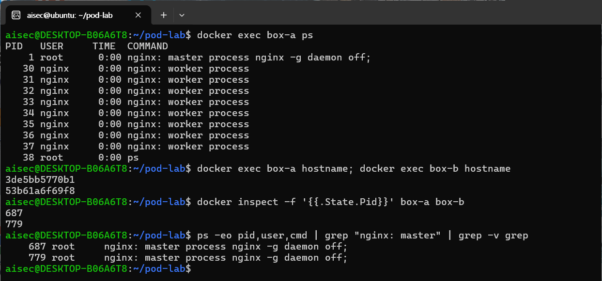
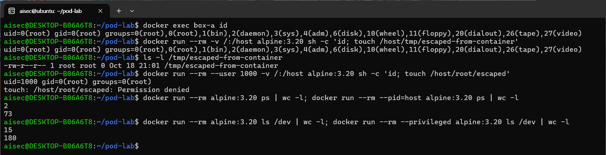
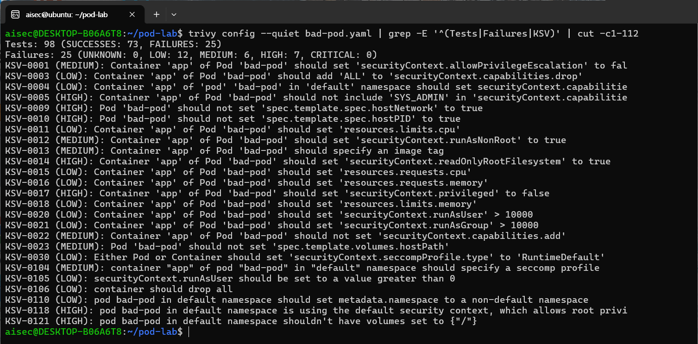
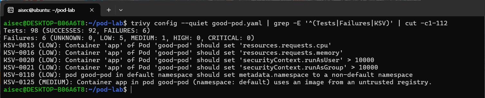
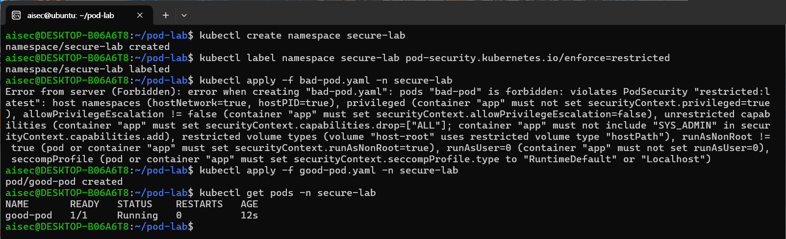

# 2장. 클라우드 네이티브 환경과 보안 — 컨테이너 격리와 Pod 보안 설정

> 책 『AI 보안, 클라우드에서 시작한다』 2장 [실습]의 코드와 단계별 안내입니다.

## 이 폴더의 파일

- `k8s/bad-pod.yaml`
- `k8s/good-pod.yaml`
- `ch02_lab1_container_isolation.ipynb`: 실습 1을 Jupyter 노트북에서 셀 단위로 실행하는 버전(과제 포함)

---

# 실습 1. 컨테이너 격리의 벽과 그 벽을 무너뜨리는 설정 확인해보기

> 2장 [실습] 1번의 단계별 안내입니다. 그림 2-2에서 본 리눅스 컨테이너의 격리(네임스페이스·cgroups)를 직접 확인하고, 설정 한 줄로 그 격리가 무너지는 모습을 봅니다. 소요 시간은 30~40분입니다.
> Docker와 Trivy가 필요합니다. Windows PC라면 [8장 README](../ch08-devsecops-image-gate/README.md)의 [실습 준비]에서 WSL2·Docker·Trivy 설치를 먼저 마칩니다. 아래 결과와 화면은 2026년 10월 18일 Ubuntu 24.04(WSL2), Docker 29.1.3, Trivy 0.76.0, kind 0.24.0(쿠버네티스 1.31)에서 실행한 것입니다.

> **주의**: 3단계에서는 컨테이너 안에서 호스트에 파일을 만듭니다. 실습용 PC나 WSL에서만 하고, 회사 서버나 운영 환경에서는 하지 마세요.

## 실습 시나리오

개발팀은 "컨테이너는 VM처럼 따로 떨어져 있으니 안전하다"고 생각합니다. 급한 장애가 나면 "권한 문제 같으니 일단 다 열어 보자"며 `--privileged`나 호스트 디렉터리 마운트를 넣기도 합니다. 이 실습에서는 컨테이너가 실제로는 호스트 커널 위의 평범한 프로세스라는 점, 그리고 그런 설정 한 줄이 격리를 어떻게 없애는지 직접 확인합니다.

## 1단계. 컨테이너 두 개 띄우고 격리 확인하기

먼저 실습 파일(이 폴더의 `k8s/`)을 리눅스 홈 디렉터리로 복사하고 그 폴더로 이동합니다. 이후 명령은 모두 이 폴더에서 실행합니다.

```bash
cp -r "<이 저장소 경로>/ch02-container-security/k8s" ~/pod-lab
cd ~/pod-lab
```

버전을 고정한 경량 nginx 이미지로 컨테이너 두 개를 띄웁니다.

```bash
docker run -d --name box-a nginx:1.27-alpine
docker run -d --name box-b nginx:1.27-alpine
```

컨테이너 안에서 보이는 프로세스와 호스트명을 확인합니다.

```bash
docker exec box-a ps
docker exec box-a hostname
docker exec box-b hostname
```

```text
PID   USER     TIME  COMMAND
    1 root      0:00 nginx: master process nginx -g daemon off;
   30 nginx     0:00 nginx: worker process
   ...
   38 root      0:00 ps
3de5bb5770b1
53b61a6f69f8
```

box-a 안에서는 nginx가 **1번 프로세스**이고, box-b의 프로세스는 보이지 않습니다. 호스트명도 컨테이너마다 다릅니다. PID 네임스페이스와 UTS 네임스페이스가 "볼 수 있는 범위"를 나눈 결과입니다.

이번에는 같은 프로세스를 **호스트에서** 봅니다.

```bash
docker inspect -f '{{.State.Pid}}' box-a box-b
ps -eo pid,user,cmd | grep "nginx: master" | grep -v grep
```

```text
687
779
    687 root     nginx: master process nginx -g daemon off;
    779 root     nginx: master process nginx -g daemon off;
```

컨테이너 안에서 1번이던 프로세스가 호스트에서는 687번, 779번 같은 평범한 프로세스입니다(번호는 실행할 때마다 다릅니다). 그림 2-2 아래쪽의 "호스트에서 본 모습"이 바로 이것입니다.



*[화면 2-1] 컨테이너 안과 호스트에서 본 프로세스*

## 2단계. 컨테이너 안의 root는 호스트에서 누구인가

```bash
docker exec box-a id
```

```text
uid=0(root) gid=0(root) groups=0(root),...
```

컨테이너 안의 사용자는 root(UID 0)입니다. 1단계에서 호스트의 `ps`로 본 USER 열도 **root**였습니다. 도커는 기본 설정에서 User 네임스페이스를 쓰지 않으므로(2-1), 컨테이너 안의 root가 곧 호스트의 root입니다. 지금은 다른 네임스페이스의 벽이 막아 주고 있을 뿐입니다. 다음 단계에서 그 벽을 하나씩 걷어 봅니다.

## 3단계. 설정 한 줄로 벽 무너뜨리기

**① 호스트의 루트 경로 마운트(`-v /:/host`)**

```bash
docker run --rm -v /:/host alpine:3.20 sh -c 'id; touch /host/tmp/escaped-from-container'
ls -l /tmp/escaped-from-container        # 호스트에서 확인
```

```text
uid=0(root) gid=0(root) ...
-rw-r--r-- 1 root root 0 Oct 18 21:01 /tmp/escaped-from-container
```

컨테이너 안에서 만든 파일이 **호스트의 /tmp에 root 소유로** 생겼습니다. 같은 방법으로 호스트의 설정 파일, 다른 컨테이너의 데이터, 인증서도 읽고 바꿀 수 있습니다. 컨테이너 안의 root와 호스트 경로 마운트가 만나면, 컨테이너는 사실상 호스트 그 자체가 됩니다.

같은 마운트라도 일반 사용자로 실행하면 결과가 달라집니다.

```bash
docker run --rm --user 1000 -v /:/host alpine:3.20 sh -c 'id; touch /host/root/escaped'
```

```text
uid=1000 gid=0(root) groups=0(root)
touch: /host/root/escaped: Permission denied
```

root로 실행하지 않는 것만으로도 피해 범위가 크게 줄어듭니다. 그래도 일반 사용자가 읽을 수 있는 호스트 파일은 여전히 보이므로, 근본 대책은 필요 없는 호스트 경로를 마운트하지 않는 것입니다.

**② 호스트 프로세스 공유(`--pid=host`)**

```bash
docker run --rm alpine:3.20 ps | wc -l
docker run --rm --pid=host alpine:3.20 ps | wc -l
```

```text
2
73
```

기본 설정에서는 머리글과 자기 자신(`ps`) 두 줄만 보이지만, `--pid=host`를 붙이면 호스트와 다른 컨테이너의 프로세스가 모두 보입니다(숫자는 환경마다 다릅니다). PID 네임스페이스의 벽이 사라진 것입니다.

**③ 모든 권한 부여(`--privileged`)**

```bash
docker run --rm alpine:3.20 ls /dev | wc -l
docker run --rm --privileged alpine:3.20 ls /dev | wc -l
```

```text
15
180
```

`--privileged` 컨테이너에는 호스트의 디스크와 장치가 거의 모두 보입니다. 장치에 직접 접근하고 커널 기능을 마음대로 쓸 수 있어, 2-2에서 본 컨테이너 탈출로 가는 가장 짧은 길이 됩니다.



*[화면 2-2] 격리를 무너뜨리는 설정*

`[표 실습2-1]` 격리를 무너뜨리는 설정과 확인 결과

| 설정 | 사라지는 벽 | 확인한 결과 | 같은 뜻의 Pod 설정 |
|---|---|---|---|
| (기본값) root로 실행 | User 네임스페이스 없음 | 컨테이너의 root가 호스트에서도 root | `runAsUser: 0` |
| `-v /:/host` | Mount 네임스페이스 | 호스트에 root 소유 파일 생성 | `hostPath: /` |
| `--pid=host` | PID 네임스페이스 | 보이는 프로세스 2줄 → 73줄 | `hostPID: true` |
| `--privileged` | 장치·커널 권한 제한 | /dev 항목 15개 → 180개 | `privileged: true` |

## 4단계. 배포 전에 설정 파일에서 찾기

3단계에서는 명령어 옵션으로 실행했지만, 실제 운영에서는 같은 설정이 쿠버네티스 Pod 설정 파일(YAML)에 들어갑니다. 1단계에서 복사한 `bad-pod.yaml`에는 표 실습2-1의 위험 설정이 모두 들어 있습니다. **실제 클러스터에는 배포하지 마세요.**

```yaml
apiVersion: v1
kind: Pod
metadata:
  name: bad-pod
spec:
  hostNetwork: true            # ① 노드의 네트워크를 그대로 사용
  hostPID: true                # ② 노드의 모든 프로세스가 보임
  containers:
  - name: app
    image: nginx:latest        # ③ 버전이 고정되지 않은 이미지
    securityContext:
      privileged: true         # ④ 노드의 거의 모든 권한을 가짐
      runAsUser: 0             # ⑤ root로 실행
      allowPrivilegeEscalation: true
      capabilities:
        add: ["SYS_ADMIN"]     # ⑥ 강력한 커널 권한 추가
    volumeMounts:
    - name: host-root
      mountPath: /host
  volumes:
  - name: host-root
    hostPath:
      path: /                  # ⑦ 노드의 루트 파일시스템 전체를 마운트
```

도구를 쓰기 전에 표 실습2-1의 오른쪽 열과 비교하며 위험한 줄을 직접 찾아봅니다. 그다음 Trivy로 점검합니다. 클러스터 없이 파일만으로 점검할 수 있습니다.

```bash
trivy config bad-pod.yaml
```

```text
Tests: 98 (SUCCESSES: 73, FAILURES: 25)
Failures: 25 (UNKNOWN: 0, LOW: 12, MEDIUM: 6, HIGH: 7, CRITICAL: 0)
```

`[표 실습2-2]` bad-pod.yaml에서 Trivy가 찾은 주요 항목

| 번호 | 설정 | Trivy 규칙 | 위험 |
|---|---|---|---|
| ① | `hostNetwork: true` | KSV-0009 (HIGH) | 노드의 네트워크를 그대로 써서, 노드 내부 서비스와 다른 Pod의 통신에 접근 |
| ② | `hostPID: true` | KSV-0010 (HIGH) | 3단계 ②처럼 노드의 모든 프로세스가 보임 |
| ③ | `image: nginx:latest` | KSV-0013 (MEDIUM) | 언제 어떤 버전이 배포될지 모름 |
| ④ | `privileged: true` | KSV-0017 (HIGH) | 3단계 ③처럼 격리가 사실상 해제됨 |
| ⑤ | `runAsUser: 0` | KSV-0012 (MEDIUM) | 2단계처럼 노드의 root와 같은 사용자로 실행 |
| ⑥ | `capabilities.add: SYS_ADMIN` | KSV-0005 (HIGH) | 마운트 같은 커널 수준의 강력한 작업 가능 |
| ⑦ | `hostPath: /` | KSV-0023 (MEDIUM), KSV-0121 (HIGH) | 3단계 ①처럼 노드의 파일시스템 전체를 읽고 씀 |

④와 ⑦이 함께 있으면, 컨테이너에 들어온 공격자가 `/host`를 통해 노드의 파일을 바꾸고 노드에서 명령을 실행하는 **컨테이너 탈출**이 가능합니다. Trivy는 사람이 놓치기 쉬운 항목도 함께 찾습니다. 자원 한도 없음(KSV-0011, KSV-0018), 읽기 전용 파일시스템 미적용(KSV-0014), seccomp 미설정(KSV-0030) 같은 것입니다.

전체 결과는 규칙마다 해당 코드 줄까지 보여 주어 길기 때문에, 화면에서는 요약 줄과 규칙 줄만 골라 보았습니다(`| grep -E '^(Tests|Failures|KSV)'`).



*[화면 2-3] bad-pod.yaml 점검 결과*

이제 안전하게 고친 `good-pod.yaml`을 점검합니다.

```yaml
apiVersion: v1
kind: Pod
metadata:
  name: good-pod
spec:
  automountServiceAccountToken: false   # 필요 없으면 API 토큰을 넣지 않음
  securityContext:
    runAsNonRoot: true
    runAsUser: 101                       # nginx 사용자
    seccompProfile:
      type: RuntimeDefault               # 위험한 시스템 호출 차단
  containers:
  - name: app
    image: nginxinc/nginx-unprivileged:1.27-alpine   # 버전 고정, 비root용 이미지
    ports:
    - containerPort: 8080
    securityContext:
      privileged: false
      allowPrivilegeEscalation: false
      readOnlyRootFilesystem: true
      capabilities:
        drop: ["ALL"]                    # 모든 커널 권한 제거
    resources:
      limits:
        cpu: "250m"
        memory: "128Mi"
    volumeMounts:
    - name: tmp
      mountPath: /tmp                    # 쓰기가 필요한 곳만 별도 제공
  volumes:
  - name: tmp
    emptyDir: {}
```

```bash
trivy config good-pod.yaml
```

```text
Tests: 98 (SUCCESSES: 92, FAILURES: 6)
Failures: 6 (UNKNOWN: 0, LOW: 5, MEDIUM: 1, HIGH: 0, CRITICAL: 0)
```



*[화면 2-4] good-pod.yaml 점검 결과*

HIGH가 0건이 되었습니다. 남은 6건은 자원 요청값 미지정(KSV-0015, KSV-0016), UID·GID 번호가 10000 이하(KSV-0020, KSV-0021), default 네임스페이스 사용(KSV-0110), 신뢰한 레지스트리로 제한하지 않음(KSV-0125)입니다. 이 가운데 무엇을 운영에서 받아들이고 무엇을 고칠지 판단해 보세요. 모든 경고로 배포를 막지 않고 "막을 것과 알릴 것"을 나누는 2-3의 원칙이 여기에 적용됩니다.

## 5단계. (선택) 클러스터가 위험한 Pod를 거부하게 만들기

4단계가 위험한 설정을 "찾는" 것이라면, 5단계는 사람이 실수로 넣어도 클러스터가 배포 단계에서 "막는" 것입니다. 쿠버네티스 클러스터가 없다면 Docker 위에서 도는 실습용 클러스터 kind로 만들 수 있습니다. 내려받은 파일은 공식 체크섬으로 확인합니다.

```bash
mkdir -p ~/bin && cd ~/bin
curl -fsSLo kind https://github.com/kubernetes-sigs/kind/releases/download/v0.24.0/kind-linux-amd64
curl -fsSLo kind.sha256 https://github.com/kubernetes-sigs/kind/releases/download/v0.24.0/kind-linux-amd64.sha256sum
echo "$(awk '{print $1}' kind.sha256)  kind" | sha256sum -c
curl -fsSLo kubectl https://dl.k8s.io/release/v1.31.1/bin/linux/amd64/kubectl
echo "$(curl -fsSL https://dl.k8s.io/release/v1.31.1/bin/linux/amd64/kubectl.sha256)  kubectl" | sha256sum -c
chmod +x kind kubectl && export PATH=~/bin:$PATH
kind create cluster --name pod-lab --image kindest/node:v1.31.0    # 처음에는 노드 이미지를 받느라 몇 분 걸림
```

쿠버네티스에는 Pod Security Admission이라는 검사 기능이 기본으로 들어 있습니다. 네임스페이스에 라벨 하나를 붙이면, 그 네임스페이스에 들어오는 모든 Pod를 쿠버네티스 공식 기준인 Pod Security Standards로 검사합니다.

```bash
cd ~/pod-lab
kubectl create namespace secure-lab
kubectl label namespace secure-lab pod-security.kubernetes.io/enforce=restricted
kubectl apply -f bad-pod.yaml -n secure-lab
kubectl apply -f good-pod.yaml -n secure-lab
kubectl get pods -n secure-lab
```

```text
Error from server (Forbidden): error when creating "bad-pod.yaml": pods "bad-pod" is forbidden:
violates PodSecurity "restricted:latest": host namespaces (hostNetwork=true, hostPID=true),
privileged (...), allowPrivilegeEscalation != false (...), unrestricted capabilities (...),
restricted volume types (...), runAsNonRoot != true (...), runAsUser=0 (...), seccompProfile (...)
pod/good-pod created
NAME       READY   STATUS    RESTARTS   AGE
good-pod   1/1     Running   0          12s
```



*[화면 2-5] restricted 네임스페이스의 배포 결과*

라벨 `pod-security.kubernetes.io/enforce=restricted`는 두 가지를 정합니다. 앞의 **enforce**는 기준을 어긴 Pod를 어떻게 다룰지(모드)이고, 뒤의 **restricted**는 어떤 기준으로 검사할지(단계)입니다.

`[표 실습2-3]` Pod Security Admission의 모드와 단계

| 구분 | 값 | 뜻 |
|---|---|---|
| 모드 | `enforce` | 기준을 어긴 Pod의 생성을 거부 |
| | `warn` | 생성은 허용하고, 명령을 실행한 사람에게 경고만 표시 |
| | `audit` | 생성은 허용하고, 클러스터 감사 로그에만 기록 |
| 단계 | `privileged` | 제한 없음 (시스템 관리용 Pod 전용) |
| | `baseline` | 알려진 권한 상승 경로를 막는 최소 기준 (호스트 네임스페이스, privileged, hostPath 등 금지) |
| | `restricted` | baseline에 더해 root 실행 금지, 권한 상승 금지, 커널 권한 전부 제거 같은 강화 기준까지 요구 |

bad-pod가 거부된 이유는 거부 메시지에 규칙 이름으로 그대로 나옵니다. 메시지의 각 항목은 다음 규칙에 해당합니다.

`[표 실습2-4]` bad-pod가 어긴 restricted 규칙

| 거부 메시지의 항목 | 규칙 | 단계 | bad-pod의 설정 |
|---|---|---|---|
| host namespaces | 노드의 네트워크·프로세스·IPC 공유 금지 | baseline | `hostNetwork: true`, `hostPID: true` |
| privileged | 특권 컨테이너 금지 | baseline | `privileged: true` |
| allowPrivilegeEscalation != false | 권한 상승을 명시적으로 막아야 함 | restricted | `allowPrivilegeEscalation: true` |
| unrestricted capabilities | 커널 권한을 모두 버리고(`drop: ALL`) `NET_BIND_SERVICE`만 추가 가능 | restricted | `SYS_ADMIN` 추가, `drop` 없음 |
| restricted volume types | configMap, emptyDir, secret 같은 허용된 볼륨만 사용 (hostPath 금지) | restricted | `hostPath: /` |
| runAsNonRoot != true, runAsUser=0 | root로 실행 금지 | restricted | `runAsUser: 0` |
| seccompProfile | seccomp 프로필을 RuntimeDefault나 Localhost로 지정 | restricted | 지정 없음 |

good-pod는 이 규칙을 모두 지켰기 때문에 그대로 실행되었습니다. 다만 Pod Security Standards는 실행 권한만 봅니다. 4단계에서 Trivy가 찾은 `nginx:latest`(버전 고정 안 됨, KSV-0013)나 신뢰하지 않은 레지스트리(KSV-0125)는 검사하지 않으므로, 이런 규칙까지 배포 단계에서 강제하려면 Kyverno나 OPA Gatekeeper 같은 별도 정책 도구가 필요합니다. 운영 중인 클러스터에 처음 적용할 때는 `warn`이나 `audit`으로 먼저 걸리는 Pod를 확인한 뒤 `enforce`로 바꾸는 순서가 안전합니다.

## 정리

```bash
docker rm -f box-a box-b
sudo rm -f /tmp/escaped-from-container
docker rmi nginx:1.27-alpine alpine:3.20
kind delete cluster --name pod-lab                          # 5단계를 했다면
```

## 체크포인트

- [ ] 컨테이너 안의 PID 1이 호스트에서는 평범한 프로세스라는 것을 확인했나요?
- [ ] 컨테이너 안의 root가 호스트에서도 root로 실행되고 있다는 것을 확인했나요?
- [ ] `-v /:/host`, `--pid=host`, `--privileged`가 각각 어떤 벽을 없애는지 설명할 수 있나요?
- [ ] 같은 위험 설정을 Pod 설정 파일에서 배포 전에 찾고 고쳤나요?

> 이미지 안에 든 패키지의 취약점(CVE)은 8장 실습 1에서 직접 만든 이미지로 스캔하고, 보안 Gate로 배포 여부를 판정합니다.
