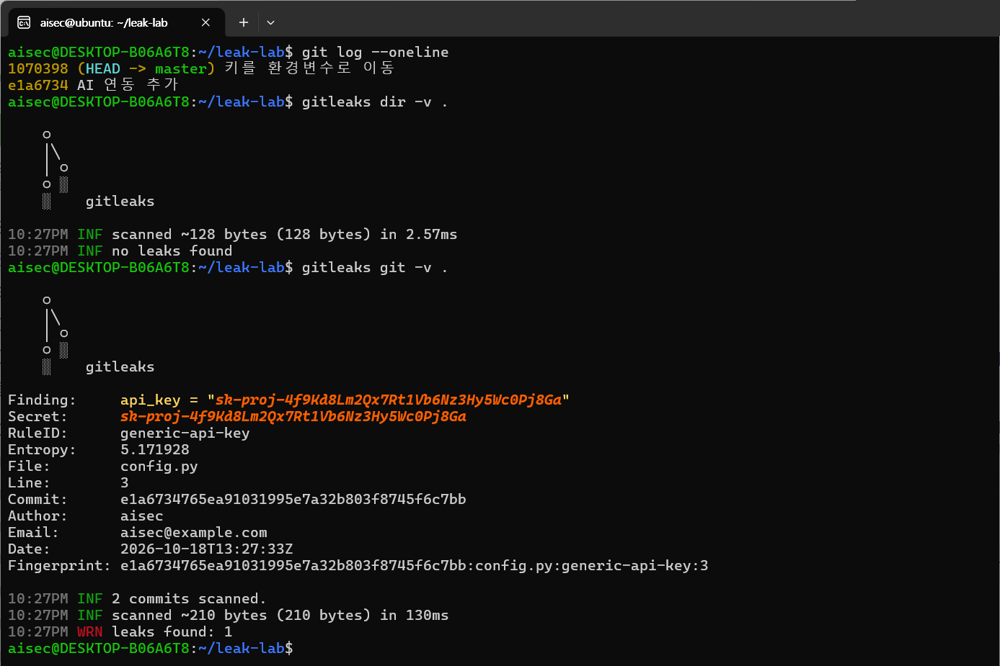

# 4장. 기업의 AI 사용 유형별 보안 — 데이터 처리 옵션, 사용 유형 자가진단, 키 유출 탐지

> 책 『AI 보안, 클라우드에서 시작한다』 4장 [실습]의 코드와 단계별 안내입니다.

## 이 폴더의 파일

- `.pre-commit-config.yaml`
- `ch04_lab3_gitleaks_api_key.ipynb`: 실습 3을 Jupyter 노트북에서 셀 단위로 실행하는 버전(과제 포함, 출력 없음). 실행 결과가 저장된 버전은 `ch04_lab3_gitleaks_api_key_executed.ipynb`

---

# 실습 1. 공개 AI 서비스의 데이터 처리 옵션 확인하기

> 4장 [실습] 1번의 단계별 안내입니다. 개인 계정으로 쓰는 공개 AI 서비스 하나를 골라, 입력한 데이터가 어떻게 처리되는지 설정과 정책 문서에서 직접 확인합니다. 소요 시간은 20~30분입니다.
> 각 서비스의 메뉴 이름과 위치는 자주 바뀝니다. 아래 안내와 다르면 서비스의 도움말에서 "데이터 제어", "개인정보 보호", "학습" 같은 단어로 검색하세요.

## 실습 시나리오

영업팀 직원이 고객 목록을 정리하려고 개인 계정의 AI 서비스에 고객 이름과 연락처를 붙여넣으려 합니다. 붙여넣는 순간 이 데이터는 어디에 얼마나 남고, AI 학습에 쓰일까요? 직원 100명이 각자 설정을 바꿔야 한다면 어떤 일이 생길까요?

## 1단계. 학습 활용 설정 찾기

서비스 하나를 골라 설정 메뉴에서 "대화 내용을 모델 개선(학습)에 쓸지"를 정하는 옵션을 찾습니다.

아래 위치는 2026년 10월 기준이며, 서비스 화면이 바뀌면 달라질 수 있습니다.

`[표 실습4-1]` 주요 공개 AI 서비스의 학습 설정 위치

| 서비스 | 확인할 위치 (예시) | 관련 기능 |
|---|---|---|
| ChatGPT | 설정 → 데이터 제어 → "모두를 위한 모델 개선" | 임시 채팅(기록·학습 제외) |
| Claude | 설정 → 개인정보 보호 → 모델 개선 참여 여부 | 대화 삭제 |
| Gemini | Gemini 앱 활동(Gemini Apps Activity) 설정 | 활동 기록 끄기, 자동 삭제 기간 |
| Microsoft Copilot (개인) | 설정 → 개인정보 → 모델 학습 관련 옵션 | 대화 기록 삭제 |

현재 상태(켜짐/꺼짐)와 **기본값이 무엇이었는지**를 기록합니다. 처음 가입했을 때부터 학습 제외가 기본이었나요, 아니면 직접 꺼야 했나요?

## 2단계. 정책 문서에서 보존·삭제 확인

서비스의 개인정보처리방침(Privacy Policy)과 이용약관에서 아래 항목을 찾습니다. 브라우저의 찾기(Ctrl+F)로 "보존", "삭제", "학습", "개선", "제3자", "국외", "retention", "training"을 검색하면 빠릅니다.

`[표 실습4-2]` 공개 AI 서비스 데이터 처리 확인표

| 확인 항목 | 찾은 내용 | 찾은 위치(문서·조항) |
|---|---|---|
| 대화 내용의 모델 학습 활용 여부와 기본값 | | |
| 학습을 꺼도 남는 데이터 (예: 남용 감시용 보존) | | |
| 대화 기록 보존 기간 | | |
| 삭제 요청 방법과 삭제까지 걸리는 기간 | | |
| 사람(검토자)이 대화를 볼 수 있는지 | | |
| 데이터 처리 국가·국외 이전 | | |
| 기업용 요금제와 다른 점 | | |

## 3단계. 더미 개인정보 입력해 보기

**실제 개인정보가 아닌 가상의 데이터만** 씁니다.

```text
다음 고객 명단을 지역별로 정리해 줘.
홍길동, 010-1234-5678, 서울시 중구 세종대로 110, 생년월일 1990-01-01
김철수, 010-9876-5432, 부산시 연제구 중앙대로 1001, 생년월일 1985-05-05
```

- 서비스가 개인정보 입력에 대해 경고를 보여주나요?
- 아무 경고 없이 정리해 준다면, 회사 보안팀은 이 입력을 알 수 있을까요? (4-1의 "문제점 2. 기존 네트워크 보안으로는 보이지 않는다" 참고)

실습이 끝나면 이 대화를 삭제합니다.

## 4단계. 조직 관점으로 정리하기

| 질문 | 나의 답 |
|---|---|
| 학습 제외 옵션이 기본으로 켜져 있었나? | |
| 직원 100명이 각자 설정을 바꿔야 한다면, 회사는 그 상태를 확인할 수 있나? | |
| 학습을 꺼도 남는 데이터가 있었나? | |
| 기업용 요금제로 바꾸면 무엇이 달라지나? | |

## 체크포인트

- [ ] 학습 제외 옵션이 기본으로 켜져 있었나요, 직접 꺼야 했나요?
- [ ] 학습을 꺼도 일정 기간 보존되는 데이터가 있다는 것을 확인했나요?
- [ ] 직원 개개인의 설정에 의존하는 방식의 한계는 무엇일까요? 회사가 중앙에서 통제하려면 무엇이 필요할까요? (기업용 계약, SSO, 브라우저·DLP 통제)

---

# 실습 2. 우리 조직의 AI 사용 유형 자가진단

> 4장 [실습] 2번의 단계별 안내입니다. 실제 조직 또는 가상 조직의 AI 사용 현황을 4장의 네 가지 유형으로 분류하고, 유형별 핵심 통제가 갖춰져 있는지 점검합니다. 소요 시간은 30~40분입니다.

## 1단계. AI 사용 현황 수집

부서별로 사용 중인 AI 서비스를 모두 적습니다. 정식으로 도입한 것뿐 아니라 **직원들이 개인적으로 쓰는 것**도 포함합니다. 모르면 부서 담당자에게 "업무에 쓰는 AI 도구가 있나요?"라고 물어보는 것부터 시작합니다.

## 2단계. 유형 분류와 통제 점검

각 서비스를 4가지 유형 중 하나로 분류하고, 표 4-4의 "핵심 통제"가 적용되어 있는지 O(적용)·△(일부)·X(미적용)로 표시합니다. 데이터 등급은 표 4-1의 네 등급(공개, 내부, 기밀, 극비·규제)으로 적습니다.

`[표 실습4-3]` AI 사용 유형 자가진단 워크시트 양식

| 부서 | AI 서비스 | 유형 (공개형 / 기업용 SaaS / API·RAG / 자체 모델) | 다루는 데이터 등급 | 핵심 통제 ① | 핵심 통제 ② | 핵심 통제 ③ | 비고 |
|---|---|---|---|---|---|---|---|
| | | | | | | | |

유형별 핵심 통제 항목은 다음과 같습니다.

| 유형 | 핵심 통제 ① | 핵심 통제 ② | 핵심 통제 ③ |
|---|---|---|---|
| 공개형 AI | 승인 서비스 목록 | 브라우저·엔드포인트 DLP | 개인 계정 사용 통제 |
| 기업용 AI SaaS·Copilot | 문서 권한 정리 | 민감도 레이블 | Connector·플러그인 통제 |
| API·RAG 서비스 | AI Gateway·키 관리 | 출력 검증·권한 필터 | Rate Limit·비용 한도 |
| 자체 모델 | Model Registry·서명 | 학습 데이터 보호 | 서빙 서버 인증·패치 |

## 작성 예시 (가상 기업 "한빛제조")

`[표 실습4-4]` AI 사용 유형 자가진단 작성 예시

| 부서 | AI 서비스 | 유형 | 데이터 등급 | 통제 ① | 통제 ② | 통제 ③ | 비고 |
|---|---|---|---|---|---|---|---|
| 영업팀 | ChatGPT (개인 계정) | 공개형 | 내부·기밀 | X | X | X | 고객 명단 입력 사례 확인 |
| 디자인팀 | 이미지 생성 AI (개인 결제) | 공개형 | 내부 | X | X | X | 법인카드 비용 처리로 발견 |
| 전사 | Microsoft 365 Copilot | 기업용 SaaS | 내부·기밀 | △ | X | O | 인사 폴더 "전사 공개" 권한 발견 |
| 고객지원팀 | 상담 요약 챗봇 (API + RAG) | API·RAG | 개인정보 | X | △ | X | API Key가 코드에 하드코딩 |
| 생산기술팀 | 불량 검출 모델 (자체 학습) | 자체 모델 | 기밀 | X | O | △ | 추론 서버가 사내망에 인증 없이 열려 있음 |

**예시에서 읽어야 할 것**: X가 가장 많은 유형은 **공개형 AI**입니다. 공식 도입 절차를 거치지 않아 아무 통제가 없기 때문입니다. 반면 위험이 가장 큰 곳은 개인정보를 다루면서 키가 하드코딩된 **API·RAG 서비스**일 수 있습니다. X의 개수와 데이터 등급을 함께 보고 우선순위를 정합니다.

## 체크포인트

- [ ] 가장 많은 X가 나온 유형은 무엇인가요?
- [ ] X가 많은 유형과 데이터 등급이 높은 유형이 겹치는 곳이 있나요? 그곳이 1순위입니다.
- [ ] X가 나온 칸마다 고칠 담당자를 정했나요? 서비스별 레이어 담당자는 3장 실습 3의 정리표에서 찾습니다.
- [ ] 이 목록에 처음 알게 된 서비스(Shadow AI)가 있었나요? 그 서비스는 차단할까요, 정식 도입할까요? (4-1, 10-1)

---

# 실습 3. 코드 저장소의 하드코딩된 API Key 찾기

> 4장 [실습] 3번의 단계별 안내입니다. Gitleaks로 Git 저장소에 남아 있는 비밀정보를 찾고, 이미 커밋한 키를 어떻게 처리해야 하는지 확인합니다. 소요 시간은 30분입니다.
> **반드시 가짜 키로만 실습하세요.** 실제 키를 저장소에 올리면 몇 분 안에 자동 스캐너에 수집될 수 있습니다.

## 1단계. Gitleaks 설치

```bash
# macOS
brew install gitleaks

# Windows (winget)
winget install Gitleaks.Gitleaks

# 또는 GitHub Releases에서 운영체제에 맞는 바이너리 내려받기
gitleaks version
```

## 2단계. 실습용 저장소 만들고 가짜 키 커밋하기

```bash
mkdir leak-lab && cd leak-lab
git init

# 가짜 키가 들어간 설정 파일 (실제 키 아님)
cat > config.py << 'EOF'
# AI 서비스 연동 설정
LLM_ENDPOINT = "https://api.example-ai.com/v1/chat"
api_key = "sk-proj-4f9Kd8Lm2Qx7Rt1Vb6Nz3Hy5Wc0Pj8Ga"
EOF

git add config.py
git commit -m "AI 연동 추가"
```

## 3단계. 실수를 "고친" 척하기

개발자가 실수를 알아채고 키를 지웠습니다.

```bash
cat > config.py << 'EOF'
import os
LLM_ENDPOINT = "https://api.example-ai.com/v1/chat"
api_key = os.environ["LLM_API_KEY"]   # 환경변수에서 읽기
EOF

git commit -am "키를 환경변수로 이동"
```

지금 파일에는 키가 없습니다. 안전해졌을까요?

## 4단계. 저장소 이력 전체 스캔

```bash
# 저장소의 모든 커밋 이력 검사 (Gitleaks 8.19 이상)
gitleaks git -v .

# 이전 버전에서는
gitleaks detect -v --source .

# 현재 파일만 검사 (이력 제외)
gitleaks dir -v .
```

현재 파일만 검사하면 "no leaks found"가 나오지만, 이력 전체를 검사하면 키가 들어 있던 첫 커밋의 ID, 파일과 줄 번호, 탐지 규칙 이름(generic-api-key)이 나옵니다. 이 책의 화면은 WSL2의 Ubuntu 24.04에서 Gitleaks 8.24.0으로 실행했습니다.



*[화면 4-1] 현재 파일 검사와 저장소 이력 검사 결과*

`[표 실습4-5]` 스캔 범위에 따른 결과 비교

| 스캔 방식 | 키 발견 여부 | 의미 |
|---|---|---|
| 현재 파일만 (`gitleaks dir`) | 발견 안 됨 | 지금 코드에는 키가 없음 |
| 저장소 이력 전체 (`gitleaks git`) | **발견됨** | 첫 번째 커밋에 키가 그대로 남아 있음 |

> 탐지 여부는 Gitleaks 버전과 규칙에 따라 다를 수 있습니다. 가짜 키가 탐지되지 않으면 `api_key = "..."` 형태로 다시 쓰거나, 더 긴 무작위 문자열로 바꿔 보세요. 일반 키 규칙(`generic-api-key`)은 "키 이름 + 무작위성이 높은 값"을 찾습니다.

## 5단계. 이미 커밋된 키는 어떻게 처리하나?

순서가 중요합니다.

1. **키부터 폐기·재발급합니다.** 이력에서 지우는 것보다 먼저입니다. 원격 저장소에 한 번이라도 올라갔다면, 이미 누군가 복사해 갔다고 가정해야 합니다.
2. **이력에서 제거합니다.** `git filter-repo` 같은 도구로 해당 내용을 이력에서 지우고, 원격 저장소에 강제로 반영합니다. 다른 팀원의 복제본, 포크, CI 캐시에도 남아 있을 수 있음을 알려야 합니다.
3. **재발 방지 장치를 둡니다.** 커밋 전에 자동으로 검사하는 pre-commit 훅이나 CI 단계를 둡니다(8장 실습 1의 6단계 "파이프라인에 넣기").

```bash
# pre-commit 훅 예시: .pre-commit-config.yaml
repos:
  - repo: https://github.com/gitleaks/gitleaks
    rev: v8.24.0        # 사용하는 시점의 검증된 버전으로 고정
    hooks:
      - id: gitleaks
```

## 6단계. (선택) TruffleHog으로 교차 확인

```bash
trufflehog git file://. 
```

TruffleHog은 발견한 키가 **실제로 유효한지** 해당 서비스에 확인하는 기능(`--only-verified`)이 있습니다. 가짜 키는 "검증되지 않음"으로 나옵니다. 실무에서는 유효한 키부터 먼저 폐기합니다.

## 정리

```bash
cd .. && rm -rf leak-lab
```

## 체크포인트

- [ ] 최신 코드에서 지운 키가 저장소 이력 스캔에서 탐지되었나요?
- [ ] 이미 커밋된 키를 처리하는 올바른 순서(폐기 → 이력 제거 → 재발 방지)를 이해했나요?
- [ ] 우리 조직의 저장소 중 한 번도 이력 전체를 스캔해 본 적 없는 곳은 몇 개일까요?
