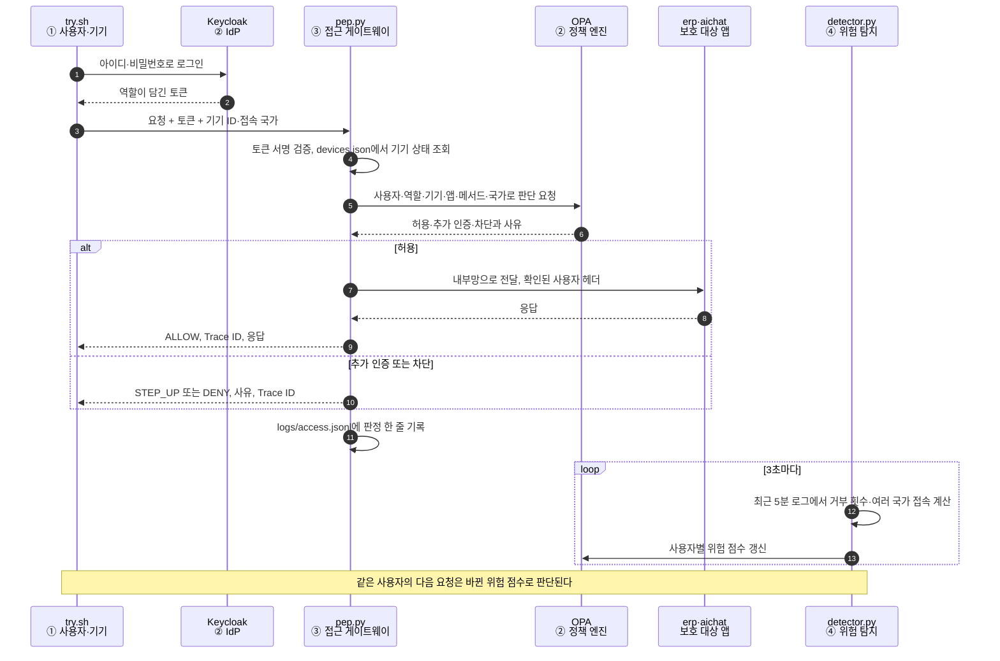
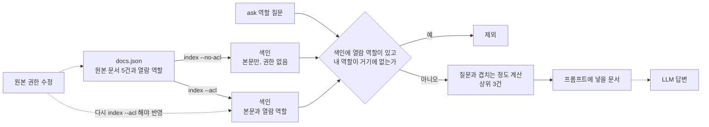

# 7장. 제로트러스트 기반 AI Cloud 보안 아키텍처 — 4계층 점검표, RAG 문서 권한, 미니 제로트러스트 랩

> 책 『AI 보안, 클라우드에서 시작한다』 7장 [실습]의 코드와 단계별 안내입니다.

## 이 폴더의 파일

- `devices.json`
- `docker-compose.yml`
- `keycloak/realm-zt.json`
- `logs/.gitkeep`
- `rag-acl/docs.json` (실습 3)
- `rag-acl/rag.py` (실습 3)
- `policy/zt.rego`
- `policy/zt_test.rego`
- `services/Dockerfile`
- `services/app.py`
- `services/detector.py`
- `services/pep.py`
- `try.sh`
- `ch07_lab2_mini_zero_trust.ipynb`: 실습 2를 Jupyter 노트북에서 셀 단위로 실행하는 버전(과제 포함, 출력 없음). 실행 결과가 저장된 버전은 `ch07_lab2_mini_zero_trust_executed.ipynb`
- `ch07_lab3_rag_document_acl.ipynb`: 실습 3을 Jupyter 노트북에서 셀 단위로 실행하는 버전(과제 포함, 출력 없음). 실행 결과가 저장된 버전은 `ch07_lab3_rag_document_acl_executed.ipynb`

---

# 실습 1. 우리 회사 제로트러스트 4계층 커버리지 점검표 만들기

> 7장 [실습] 1번의 단계별 안내입니다. 코드는 쓰지 않습니다. 회사의 주요 시스템을 그림 7-2의 네 계층에 하나씩 대어 보고, **"이 시스템은 네 계층 중 어디를 거치지 않는가?"**라는 질문에 답하는 점검표를 만듭니다. 소요 시간은 30~60분입니다.
> 실제 회사 정보를 쓰기 어렵다면 아래 예시의 가상 회사로 진행해도 됩니다. 점검표 자체가 회사의 방어 구조를 담게 되므로, 실제 정보로 작성했다면 사내 문서로만 관리합니다.

## 1단계. 점검 대상 시스템 고르기

사람이 매일 쓰는 시스템, 관리자가 쓰는 시스템, 새로 들어온 AI 서비스를 고르게 섞어 5~10개를 고릅니다.

| 구분 | 예시 |
|---|---|
| 온프레미스 업무시스템 | ERP, 그룹웨어, 인사 시스템 |
| 클라우드 관리 | AWS·Azure 관리 콘솔, 쿠버네티스 클러스터 |
| 개발 | Git 저장소, CI/CD 파이프라인 |
| SaaS | Microsoft 365, Slack, Notion |
| AI 서비스 | 사내 AI 챗봇, RAG 검색, 업무 Agent, MCP Server |

## 2단계. 점검표 틀 만들기

스프레드시트의 행에는 시스템을, 열에는 네 계층의 요건을 둡니다. 요건은 본문의 "요건" 항목을 한 줄 질문으로 바꾼 것입니다.

| 계층 | 점검 질문 |
|---|---|
| ① 사용자 | 등록된 기기에서만 접근할 수 있는가? 기기 상태(EDR·패치)를 접속 시점에 확인하는가? |
| ② 인증·권한관리 | 회사 통합 IdP로 로그인하는가? 피싱 저항 MFA를 쓰는가? 관리자 권한이 상시로 부여되어 있지 않은가? |
| ③ 컨트롤 | 게이트웨이(ZTNA·AI Gateway 등)를 거치지 않는 접근 경로가 없는가? 요청마다 정책이 적용되는가? |
| ④ 위험 탐지 | 접근 로그가 보안관제(SIEM)에 들어오는가? 위험 신호가 접근 정책에 자동으로 반영되는가? |

칸마다 **충족 / 부분 / 미충족 / 모름** 중 하나를 고르고, 판단 근거를 한 줄로 적습니다. 근거가 없으면 "충족"으로 표시하지 않습니다.

## 3단계. 채워 보기 (가상 회사 예시)

| 시스템 | ① 사용자 | ② 인증·권한관리 | ③ 컨트롤 | ④ 위험 탐지 |
|---|---|---|---|---|
| 그룹웨어 | 충족 (MDM 등록 기기만) | 충족 (IdP SSO + FIDO2) | 충족 (ZTNA 경유) | 충족 (SIEM 연동) |
| ERP | 부분 (사내망 PC만, 기기 점검 없음) | 미충족 (자체 계정) | 미충족 (VPN 접속 후 직접 접근) | 부분 (로그는 있으나 SIEM 미연동) |
| 클라우드 콘솔 | 모름 | 부분 (SSO는 되나 root 계정 Access Key 존재) | 부분 (공인 IP 제한만) | 충족 (CloudTrail → SIEM) |
| 사내 AI 챗봇 | 충족 (관리형 브라우저) | 충족 (IdP SSO) | 부분 (AI Gateway 경유, 개인 API Key 직접 호출은 못 막음) | 미충족 (프롬프트 로그 미수집) |
| 업무 Agent | 해당 없음 | 미충족 (장기 API Key 공유) | 미충족 (Egress 통제 없음) | 모름 |

## 4단계. 빈칸에 우선순위 매기기

"미충족"과 "모름" 칸을 모아 다음 두 기준으로 정렬합니다.

- **데이터 등급**: 그 시스템이 다루는 데이터가 얼마나 중요한가? (7-2)
- **노출 정도**: 외부(인터넷, 협력사)에서 닿을 수 있는가?

예시 회사라면 상위 3개 과제는 이렇게 정리됩니다.

1. 업무 Agent의 장기 API Key를 작업 단위 단기 자격증명으로 바꾸고, Egress를 목적지 허용 목록으로 제한
2. ERP를 IdP와 연동(SSO 미지원 시 IdP 연동 접근 프록시)하고 VPN 직접 접근 경로 폐쇄
3. 사내 AI 챗봇의 프롬프트·응답 로그를 마스킹 후 SIEM으로 수집

## 체크포인트

- [ ] "모름" 칸은 몇 개였나요? "모름"은 "미충족"보다 위험할 수 있습니다. 아무도 확인하지 않고 있다는 뜻이기 때문입니다.
- [ ] 한 시스템의 네 칸을 채우는 데 몇 개 팀에 물어봐야 했나요? 그 수가 곧 제로트러스트 운영의 조직 경계입니다(2장).
- [ ] 이 점검표를 분기마다 갱신하고 경영진에 보고할 주인은 누구여야 할까요? (10장 거버넌스)

---

# 실습 2. [토이 프로젝트] 내 PC에 미니 제로트러스트 랩 만들기

> 7장 [실습] 2번의 단계별 안내입니다. 그림 7-2의 네 계층을 오픈소스와 짧은 Python 코드로 연결해, 내 PC 한 대 안에 작은 "회사"를 만듭니다. 요청마다 판단하고(②), 집행하고(③), 탐지 결과가 다시 판단을 바꾸는(④→②) 흐름을 직접 확인합니다. 소요 시간은 1~2시간입니다.
> Docker가 필요합니다. Windows PC라면 [SETUP.md](../SETUP.md)의 1~5단계(WSL2·Docker 설치와 저장소 내려받기)를 먼저 진행합니다. 모든 명령은 WSL의 Ubuntu 터미널에서 실행합니다. 이 책의 실행 예시는 Ubuntu 24.04, Docker 29.1, Docker Compose 2.40에서 확인했습니다.

## 랩 구성

| 그림 7-2의 계층 | 랩의 구성요소 | 하는 일 |
|---|---|---|
| ① 사용자 | `try.sh`(요청 보내기), `devices.json`(등록 기기 목록) | 사용자·기기·접속 국가를 바꿔 가며 요청 |
| ② 인증·권한관리 | Keycloak 26(IdP), OPA 1.0(정책 엔진) | 로그인·토큰 발급, 요청마다 허용·추가 인증·차단 판단 |
| ③ 컨트롤 | `pep.py`(접근 게이트웨이) | 토큰 검증, OPA에 판단 요청, 결정 집행, 접근 로그 기록 |
| ④ 위험 탐지 | `detector.py` | 접근 로그를 3초마다 분석해 사용자별 위험 점수를 OPA에 반영 |
| 보호 대상 | `erp`, `aichat` | ERP(온프레미스 업무시스템)와 사내 AI 챗봇 역할의 작은 앱 |

```text
[try.sh] ──▶ [PEP :8000] ──판단 요청──▶ [OPA :8181] ◀──위험 점수── [detector]
   │             │                                                   ▲
   └─로그인─▶ [Keycloak :8080]   └──허용된 요청만──▶ [erp] [aichat]   │
                 │                     (내부망 back, 외부 포트 없음)    │
                 └──────────────── logs/access.jsonl ─────────────────┘
```

보호 대상 앱은 외부와 단절된 내부망(`back`)에만 붙어 있고 포트를 열지 않습니다. PEP를 거치지 않고는 닿을 길이 없습니다. 본문의 "우회 경로 없음" 요건을 구성으로 표현한 것입니다.

## 실습 흐름



*[그림 실습7-1] 실습 2의 흐름: 요청마다 신원과 기기를 확인해 판단·집행하고, 탐지 결과가 다음 판단을 바꾼다*

| 흐름의 구간 | 확인하는 단계 |
|---|---|
| 판단 요청과 결과(5~6) | 2단계 정책 규칙, 3단계 역할, 4단계 기기·패치 상태 |
| 허용된 요청만 앱으로 전달(7) | 5단계 우회 시도 |
| 위험 탐지 반복과 점수 갱신 | 6단계 미국 접속 뒤 추가 인증 |
| 판정 기록 | 7단계 Trace ID 추적 |

## 1단계. 실습 파일 준비와 실행

이 폴더(`ch07-zero-trust-lab`)를 WSL의 홈 디렉터리로 복사한 뒤 실행합니다.

```bash
# ~/ai-cloud-security-labs가 없다면 SETUP.md 5단계를 먼저 합니다
cp -r ~/ai-cloud-security-labs/ch07-zero-trust-lab ~/zt-lab
cd ~/zt-lab
chmod +x try.sh
docker compose up -d --build        # 처음에는 이미지 내려받기와 빌드에 몇 분 걸립니다
docker compose ps
```

```text
NAME                STATUS
zt-lab-aichat-1     Up 21 seconds
zt-lab-detector-1   Up 21 seconds
zt-lab-erp-1        Up 21 seconds
zt-lab-keycloak-1   Up 21 seconds
zt-lab-opa-1        Up 21 seconds
zt-lab-pep-1        Up 21 seconds
```

Keycloak은 뜨는 데 30초쯤 걸립니다. `curl -s localhost:8080/realms/zt`가 JSON을 돌려주면 준비된 것입니다.

> 실습 계정: `kim`(임직원, 역할 employee), `lee`(협력사 직원, 역할 partner). 비밀번호는 둘 다 `Passw0rd!`입니다.

> **로그인 방식에 대한 주의**
> `try.sh`는 명령줄에서 바로 시험하려고, 사용자 이름과 비밀번호를 IdP에 보내 곧바로 토큰을 받는 방식(Resource Owner Password Credentials, 흔히 Password Grant)을 씁니다. 이 방식은 앱이 사용자의 비밀번호를 직접 다루고 MFA를 거칠 수 없어서 OAuth 2.1에서 빠졌고, 실제 시스템에서는 쓰지 않습니다. 실무에서는 사용자가 브라우저로 IdP 로그인 화면에서 인증하는 방식(Authorization Code + PKCE)과 피싱 저항 MFA(7-1)를 거치게 하고, 서비스끼리의 호출에는 Client Credentials나 Workload Identity로 받은 단기 토큰을 씁니다. 이 랩의 계정과 Keycloak 설정(`keycloak/realm-zt.json`)도 실습용이므로 운영에 그대로 쓰지 않습니다.

## 2단계. 정책 엔진의 규칙 읽기

`policy/zt.rego`가 ② 정책 엔진의 판단 규칙입니다. 다음 중 하나라도 해당하면 차단합니다.

- 등록되지 않은 기기, 기기 소유자와 사용자 불일치, EDR이 동작하지 않는 기기
- 역할에 허용되지 않은 앱 (ERP는 임직원만, AI 챗봇은 임직원과 협력사)
- 보안 패치가 적용되지 않은 기기에서의 쓰기(POST) 요청
- 위험 점수 70 이상 (40~69는 차단 대신 추가 인증 요구)

규칙이 의도대로 동작하는지 정책 테스트부터 돌려 봅니다. 정책도 코드처럼 테스트를 거쳐 배포해야 합니다.

```bash
docker compose exec opa opa test /policy -v
```

```text
data.zt_test.test_kim_erp_allowed: PASS
data.zt_test.test_unmanaged_device_denied: PASS
data.zt_test.test_partner_erp_denied: PASS
data.zt_test.test_high_risk_step_up: PASS
data.zt_test.test_very_high_risk_denied: PASS
--------------------------------------------------------------------------------
PASS: 5/5
```

## 3단계. 신원과 역할에 따라 달라지는 결과

```bash
./try.sh kim LAPTOP-KIM-01 erp        # 임직원 → ERP
./try.sh lee LAPTOP-LEE-01 erp        # 협력사 → ERP
./try.sh lee LAPTOP-LEE-01 aichat     # 협력사 → AI 챗봇
```

```text
{ "decision": "ALLOW", "trace": "4e653034",
  "response": { "app": "ERP(온프레미스 업무시스템)", "user": "kim", ... } }
{ "decision": "DENY", "reasons": [ "이 앱에 대한 권한 없음" ], "trace": "b82d34ab" }
{ "decision": "ALLOW", "trace": "392c4b00",
  "response": { "app": "사내 AI 챗봇", "user": "lee", ... } }
```

같은 IdP, 같은 게이트웨이를 쓰지만 역할에 따라 닿을 수 있는 시스템이 다릅니다. ERP와 AI 챗봇이 서로 다른 보안 체계를 갖지 않고 같은 네 계층을 공유한다는 점이 핵심입니다.

## 4단계. 신원은 정상인데 차단되는 경우

```bash
./try.sh kim MY-HOME-PC erp               # 등록되지 않은 개인 PC
./try.sh lee LAPTOP-LEE-01 aichat KR POST # 패치 안 된 기기로 쓰기 요청
```

```text
{ "decision": "DENY", "reasons": [ "등록되지 않은 기기" ], "trace": "7046b9b8" }
{ "decision": "DENY", "reasons": [ "보안 패치 미적용 기기로 쓰기 요청" ], "trace": "ab9bb711" }
```

kim의 비밀번호와 토큰은 정상이지만 요청은 막혔습니다. 제로트러스트의 판단 근거는 "누구인가" 하나가 아닙니다. `devices.json`에서 `LAPTOP-LEE-01`의 `"patched"`를 `true`로 바꾸고 `docker compose restart pep`을 한 뒤 다시 보내면 통과합니다. 실제 환경에서는 이 기기 정보를 MDM·EDR이 실시간으로 알려 줍니다.

## 5단계. 우회해 보기

PEP를 건너뛰고 앱에 직접 붙어 봅니다.

```bash
curl -s -m 3 http://localhost:9000 || echo "연결 실패(우회 불가)"
docker compose exec pep python -c "import httpx;print(httpx.get('http://erp:9000/home').json())"
```

첫 번째는 연결되지 않습니다. 앱이 포트를 열지 않았기 때문입니다. 두 번째는 PEP 컨테이너 안에서 내부망으로 직접 호출한 것이라 응답이 옵니다. 이 결과가 뜻하는 바를 생각해 보세요. 집행 지점 자체가 침해되면 뒤의 모든 것이 열립니다. 그래서 PEP는 가장 단단하게 지켜야 하는 구성요소이고, 앱도 `X-Verified-User` 헤더만 믿지 말고 PEP와의 통신을 상호 인증(mTLS)으로 확인해야 합니다.

## 6단계. 위험 탐지가 정책을 바꾸는 순간

이제 kim이 몇 초 사이에 미국에서 접속한 것처럼 요청을 보냅니다. 비밀번호가 유출되어 다른 나라의 공격자가 로그인한 상황을 흉내 낸 것입니다.

```bash
./try.sh kim LAPTOP-KIM-01 erp US     # 미국에서 접속
sleep 5
docker compose logs detector | tail -3
curl -s localhost:8181/v1/data/risk   # 정책 엔진이 보고 있는 위험 점수
./try.sh kim LAPTOP-KIM-01 erp        # 다시 한국에서 접속
```

```text
detector-1  | [detector] kim: 위험 점수 0 → 15  ['최근 거부 1회']
detector-1  | [detector] lee: 위험 점수 0 → 30  ['최근 거부 2회']
detector-1  | [detector] kim: 위험 점수 15 → 65  ["5분 내 여러 국가 접속 ['KR', 'US']", '최근 거부 1회']
{"result":{"kim":65,"lee":30}}
{ "decision": "STEP_UP", "reasons": [ "위험 점수 65: 추가 인증 필요" ], "trace": "b2f62639" }
```

미국 접속 요청 자체는 허용되었습니다. 그 순간에는 판단할 근거가 없었기 때문입니다. 그러나 ④ 위험 탐지기가 로그에서 "5분 안에 두 나라"라는 신호를 찾아 위험 점수를 65로 올렸고, 정책 엔진은 같은 사용자의 다음 요청에 추가 인증을 요구했습니다. 여기서 몇 번 더 거부되면 점수가 70을 넘어 차단으로 바뀝니다. 사람이 개입하지 않고 탐지에서 정책 변경까지 몇 초 만에 이어졌습니다. 본문에서 말한 "탐지 결과가 보고서로 끝나지 않고 정책으로 되돌아가는 것"이 이것입니다.

위험 점수는 최근 5분의 로그만 보므로, 5분이 지나면 저절로 내려갑니다.

## 7단계. Trace ID로 한 요청 따라가기

모든 응답에는 `trace`가 붙어 있고, 같은 값이 `logs/access.jsonl`에 남습니다.

```bash
grep b2f62639 logs/access.jsonl
```

```text
{"trace": "b2f62639", "app": "erp", "method": "GET", "device": "LAPTOP-KIM-01", "country": "KR",
 "user": "kim", "decision": "STEP_UP", "reasons": ["위험 점수 65: 추가 인증 필요"], ...}
```

누가, 어떤 기기로, 어디서, 무엇을 요청했고, 왜 그런 결정이 내려졌는지가 한 줄에 있습니다. 9-2의 Trace ID 기반 추적이 이 기록을 사용자 요청부터 모델 호출, Tool 실행까지 넓힌 것입니다.

## 8단계. (선택) 확장해 보기

- **AI 챗봇에 실제 모델 연결**: `services/app.py`의 aichat이 로컬 모델(Ollama)을 호출하게 바꾸고, PEP 앞단에 민감정보 검사(AI Gateway 가드레일)를 추가합니다.
- **Agent 신원 추가**: Keycloak에 `agent-summary` 클라이언트를 만들고(Client Credentials), 정책에 "Agent는 GET만, ERP 쓰기 금지, 토큰 수명 5분" 규칙을 넣어 표 7-1의 위임 범위를 표현해 봅니다.
- **탐지 규칙 추가**: 심야 시간대 대량 조회, 짧은 시간의 반복 거부, 처음 보는 기기 같은 규칙을 `detector.py`에 추가합니다.

## 정리

```bash
docker compose down -v     # 컨테이너와 데이터 삭제
```

## 체크포인트

- [ ] 신원이 정상인데 차단된 요청은 어떤 근거 때문이었나요? (기기, 역할, 패치 상태, 위험 점수)
- [ ] 미국 접속 요청이 처음에는 허용된 이유는 무엇인가요? 탐지와 판단 사이의 몇 초를 더 줄이려면 무엇이 필요할까요?
- [ ] 이 랩에서 ① 사용자 계층의 기기 정보(`devices.json`)는 실제로는 어떤 시스템에서 받아야 할까요?
- [ ] PEP 컨테이너가 침해되면 어떤 일이 생기나요? 그림 7-2의 어느 계층이 이를 알아챌 수 있을까요?

---

# 실습 3. RAG 검색에 문서 권한 유지하기

> 7장 [실습] 3번의 단계별 안내입니다. 7-2 "모습이 바뀌어도 등급은 유지되어야 한다"와 4-3의 "임베딩되는 순간 권한 정보가 사라진다"를 작은 RAG 검색으로 직접 확인합니다. 소요 시간은 20~30분입니다.
> Python 3만 있으면 되고 외부 패키지와 API Key가 필요 없습니다. 아래 결과는 2026년 10월 18일 WSL2의 Ubuntu 24.04, Python 3.12에서 실행한 것입니다.

## 실습 시나리오

회사가 사내 문서를 검색해 답하는 AI 챗봇을 열었습니다. 임직원과 상주 협력사 직원이 함께 씁니다. 원본 문서 저장소에서는 인사 문서는 인사팀만, 재무 문서는 재무팀만 열 수 있습니다. 그런데 문서를 RAG 색인으로 옮기면서 이 권한도 함께 옮겨졌을까요?

3장에서 본 것처럼 AI에게 "협력사 직원에게는 재무 문서를 보여주지 마"라고 지시하는 것은 통제가 아닙니다. 권한 검사는 AI 바깥, 문서가 프롬프트에 들어가기 전인 **검색 단계**에서 해야 합니다.

## 실습 흐름



*[그림 실습7-2] 실습 3의 흐름: 원본 권한을 색인에 함께 옮기고, 검색 단계에서 역할로 거른 문서만 프롬프트에 넣는다*

1단계는 위쪽 경로(권한 없는 색인), 2단계는 아래쪽 경로(권한 포함 색인), 3단계는 점선으로 표시한 원본 권한 수정과 다시 색인하기를 따라갑니다. 권한 검사는 LLM에 닿기 전, 검색 단계의 마름모에서 끝납니다.

## 실습 파일

| 파일 | 역할 |
|---|---|
| `docs.json` | 원본 문서 5건과 문서마다 열람할 수 있는 역할(`allowed`) |
| `rag.py` | 색인 만들기(`index`)와 질문하기(`ask`). 질문과 가까운 문서를 찾아 "프롬프트에 넣을 문서"로 보여 줌 |

| 문서 | 열람할 수 있는 역할 |
|---|---|
| D1 사내 공지: 하반기 보안 교육 일정 | 임직원, 협력사, 인사팀, 재무팀 |
| D2 협력사 출입·시스템 이용 안내 | 임직원, 협력사 |
| D3 [인사] 2026년 임원 연봉 조정안 | 인사팀 |
| D4 [재무] 3분기 협력사 대금 지급 일정 | 재무팀 |
| D5 [구매] 협력사 단가 협상 내부 기준 | 임직원, **협력사** (구매팀이 실수로 협력사에 열어 둔 상태) |

> `rag.py`는 실제 RAG처럼 문서를 벡터로 바꾸지 않고, 글자 두 개씩 겹치는 정도로 질문과 가까운 문서를 찾습니다. 이 실습에서 보려는 것은 검색 기술이 아니라 **검색 결과가 누구의 권한으로 걸러지는가**입니다. Vector DB를 쓸 때도 원리는 같습니다.

## 1단계. 권한 정보 없이 색인하기

```bash
# ~/ai-cloud-security-labs가 없다면 SETUP.md 5단계를 먼저 합니다
cp -r ~/ai-cloud-security-labs/ch07-zero-trust-lab/rag-acl ~/rag-lab
cd ~/rag-lab
python3 rag.py index --no-acl
python3 rag.py ask partner "협력사 대금 지급 일정과 단가 기준 알려줘"
python3 rag.py ask employee "임원 연봉 인상률 알려줘"
```

```text
색인 5건 생성 (권한 정보 없음)
[partner] 협력사 대금 지급 일정과 단가 기준 알려줘
  → D4 [재무] 3분기 협력사 대금 지급 일정  (유사도 0.50)
  → D5 [구매] 협력사 단가 협상 내부 기준  (유사도 0.25)
  → D1 사내 공지: 하반기 보안 교육 일정  (유사도 0.19)
[employee] 임원 연봉 인상률 알려줘
  → D3 [인사] 2026년 임원 연봉 조정안  (유사도 0.56)
```

협력사 직원의 질문에 재무팀만 볼 수 있는 대금 지급 일정(D4)이, 일반 임직원의 질문에 인사팀만 볼 수 있는 임원 연봉 조정안(D3)이 프롬프트에 들어갑니다. 원본 저장소에서는 열 수 없던 문서를 AI를 거쳐 받아 가는 것입니다. 4-2의 Copilot 과다 권한 사례와 같은 구조이며, 원본 권한은 맞게 되어 있었는데 색인으로 옮기면서 사라졌다는 점이 다릅니다.

## 2단계. 원본 권한을 함께 색인하고 검색 단계에서 거르기

```bash
python3 rag.py index --acl
python3 rag.py ask partner "협력사 대금 지급 일정과 단가 기준 알려줘"
python3 rag.py ask employee "임원 연봉 인상률 알려줘"
python3 rag.py ask hr "임원 연봉 인상률 알려줘"
python3 rag.py ask finance "협력사 대금 지급 일정과 단가 기준 알려줘"
```

```text
색인 5건 생성 (권한 포함)
[partner] 협력사 대금 지급 일정과 단가 기준 알려줘
  → D5 [구매] 협력사 단가 협상 내부 기준  (유사도 0.25)
  → D1 사내 공지: 하반기 보안 교육 일정  (유사도 0.19)
  → D2 협력사 출입·시스템 이용 안내  (유사도 0.19)
[employee] 임원 연봉 인상률 알려줘
  → 프롬프트에 넣을 문서 없음
[hr] 임원 연봉 인상률 알려줘
  → D3 [인사] 2026년 임원 연봉 조정안  (유사도 0.56)
[finance] 협력사 대금 지급 일정과 단가 기준 알려줘
  → D4 [재무] 3분기 협력사 대금 지급 일정  (유사도 0.50)
  → D1 사내 공지: 하반기 보안 교육 일정  (유사도 0.19)
```

색인에 문서마다 원본 권한(`allowed`)을 붙이고, 검색할 때 사용자 역할로 먼저 거르자 D3와 D4는 각 담당 팀에게만 보입니다. 같은 질문이라도 누가 묻느냐에 따라 프롬프트에 들어가는 문서가 달라집니다. 권한 판단이 AI의 추론이 아니라 검색 단계의 확실한 규칙에서 이루어졌습니다.

그런데 협력사 직원에게 **구매팀의 단가 협상 내부 기준(D5)**은 여전히 보입니다. 원본 문서의 권한부터 협력사에 열려 있었기 때문입니다. 색인은 원본 권한을 그대로 따라갈 뿐, 원본의 실수를 바로잡지는 못합니다.

## 3단계. 원본 권한을 고친 뒤 색인을 다시 만들기

구매팀이 실수를 알아채고 원본 문서(`docs.json`)에서 D5의 열람 권한을 임직원으로 줄였습니다. `docs.json`에서 D5의 `"allowed"`를 `["employee"]`로 고친 뒤, **색인은 그대로 둔 채** 다시 질문합니다.

```bash
python3 rag.py ask partner "협력사 대금 지급 일정과 단가 기준 알려줘"
```

```text
[partner] 협력사 대금 지급 일정과 단가 기준 알려줘
  → D5 [구매] 협력사 단가 협상 내부 기준  (유사도 0.25)
  → D1 사내 공지: 하반기 보안 교육 일정  (유사도 0.19)
  → D2 협력사 출입·시스템 이용 안내  (유사도 0.19)
```

원본은 고쳤지만 색인에는 예전 권한이 남아 있어 D5가 계속 보입니다. 색인을 다시 만들어야 사라집니다.

```bash
python3 rag.py index --acl
python3 rag.py ask partner "협력사 대금 지급 일정과 단가 기준 알려줘"
```

```text
색인 5건 생성 (권한 포함)
[partner] 협력사 대금 지급 일정과 단가 기준 알려줘
  → D1 사내 공지: 하반기 보안 교육 일정  (유사도 0.19)
  → D2 협력사 출입·시스템 이용 안내  (유사도 0.19)
```

`[표 실습7-1]` 색인 방식에 따라 협력사 직원에게 보인 문서

| 단계 | D4 재무 대금 일정 | D5 구매 단가 기준 | 이유 |
|---|---|---|---|
| 권한 정보 없이 색인 | 보임 | 보임 | 색인으로 옮기며 원본 권한이 사라짐 |
| 권한을 함께 색인 | 안 보임 | 보임 | 원본 권한부터 협력사에 열려 있었음 |
| 원본만 고치고 색인은 그대로 | 안 보임 | 보임 | 색인에 예전 권한이 남음 |
| 원본을 고치고 다시 색인 | 안 보임 | 안 보임 | 원본과 색인의 권한이 일치 |

## 4단계. 실무에서는

- **권한은 원본에서 관리합니다**: 색인은 원본 권한을 따라갈 뿐입니다. 4-2의 "과다 공유 점검과 권한 정리"처럼 원본 저장소의 권한부터 정리해야 합니다.
- **권한 변경을 색인에 바로 반영합니다**: 원본 권한이 바뀌거나 문서가 삭제되면 Vector DB의 해당 조각도 바로 갱신·삭제되게 합니다(4-3 보안관리 방안 ③·⑤). 하루에 한 번 몰아서 다시 색인하면 그 사이에는 예전 권한이 살아 있습니다.
- **역할은 IdP에서 받습니다**: 이 실습에서는 역할을 명령줄로 넘겼지만, 실무에서는 사용자가 직접 정할 수 없도록 IdP가 발급한 토큰의 역할을 씁니다. 실습 2의 Keycloak 역할(employee, partner)이 바로 그 정보입니다.
- **문서 단위보다 더 잘게 나눌 수도 있습니다**: 한 문서 안에서도 일부만 민감하다면, 조각마다 등급을 붙이고 민감한 조각은 마스킹한 뒤 색인합니다(7-2).

## 정리

```bash
cd ~ && rm -rf ~/rag-lab
```

## 체크포인트

- [ ] 권한 정보 없이 색인했을 때 협력사 직원과 임직원의 질문에 섞여 들어간 문서는 무엇이었나요?
- [ ] 권한 검사가 AI의 추론이 아니라 검색 단계에서 이루어진다는 것을 확인했나요?
- [ ] 권한을 함께 색인해도 막지 못한 문서(D5)가 있었던 이유를 설명할 수 있나요?
- [ ] 원본 권한을 고친 뒤에도 결과가 바뀌지 않았다면 무엇이 빠졌던 것일까요?
