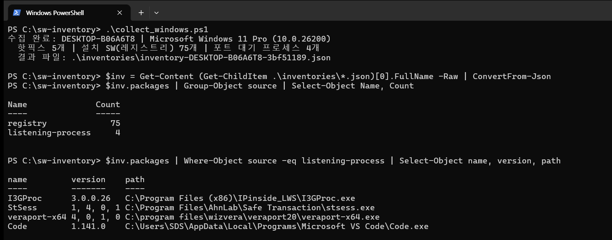
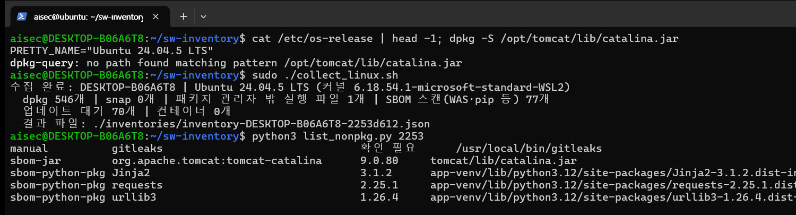
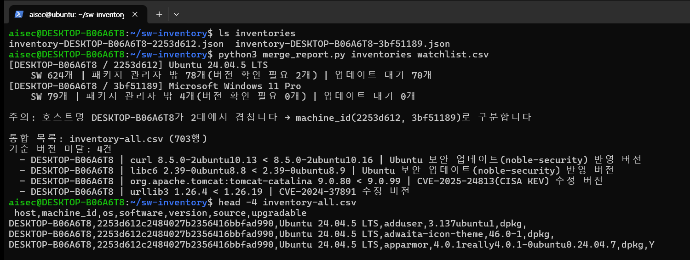
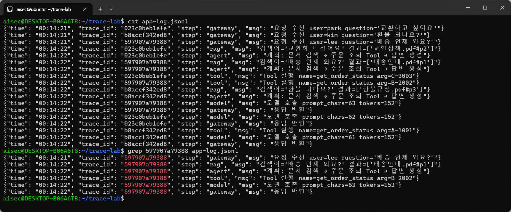
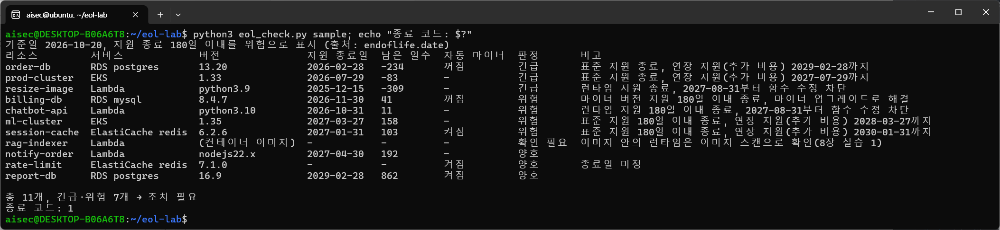
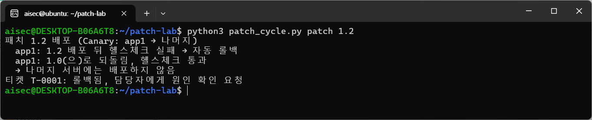
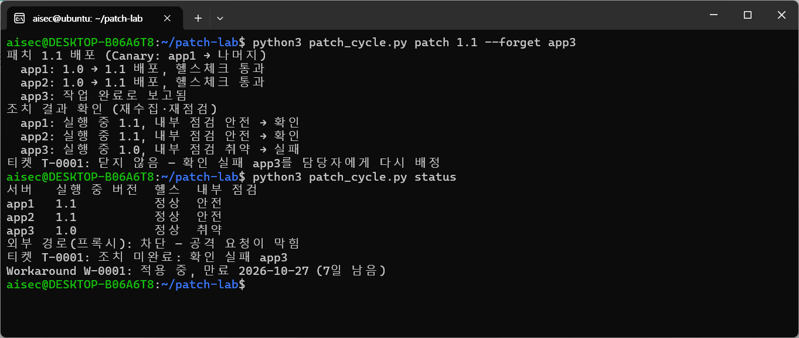

# 9장. AI 서비스 운영 보안 — SW 버전 자동 수집, Trace ID와 로그 마스킹, 클라우드 지원 종료 대조, 패치·확인·Workaround

> 책 『AI 보안, 클라우드에서 시작한다』 9장 [실습]의 코드와 단계별 안내입니다.

## 이 폴더의 파일

- `cloud-eol/collect_aws.sh`
- `cloud-eol/eol_check.py`
- `cloud-eol/sample/eks.json`
- `cloud-eol/sample/elasticache.json`
- `cloud-eol/sample/lambda.json`
- `cloud-eol/sample/rds.json`
- `patch-cycle/advisory.json`
- `patch-cycle/app/Dockerfile`
- `patch-cycle/app/app.py`
- `patch-cycle/patch_cycle.py`
- `patch-cycle/proxy/nginx.conf`
- `patch-cycle/setup.sh`
- `sw-inventory/collect_linux.sh`
- `sw-inventory/collect_windows.ps1`
- `sw-inventory/inventories/.gitkeep`
- `sw-inventory/list_nonpkg.py`
- `sw-inventory/merge_report.py`
- `sw-inventory/watchlist.csv`
- `trace/trace_app.py`
- `ch09_lab1_sw_inventory.ipynb`: 실습 1을 Jupyter 노트북에서 셀 단위로 실행하는 버전(과제 포함, 출력 없음). 실행 결과가 저장된 버전은 `ch09_lab1_sw_inventory_executed.ipynb`
- `ch09_lab2_trace_id_masking.ipynb`: 실습 2를 Jupyter 노트북에서 셀 단위로 실행하는 버전(과제 포함, 출력 없음). 실행 결과가 저장된 버전은 `ch09_lab2_trace_id_masking_executed.ipynb`
- `ch09_lab3_cloud_eol_check.ipynb`: 실습 3을 Jupyter 노트북에서 셀 단위로 실행하는 버전(과제 포함, 출력 없음). 실행 결과가 저장된 버전은 `ch09_lab3_cloud_eol_check_executed.ipynb`
- `ch09_lab4_patch_verify_workaround.ipynb`: 실습 4를 Jupyter 노트북에서 셀 단위로 실행하는 버전(과제 포함, 출력 없음). 실행 결과가 저장된 버전은 `ch09_lab4_patch_verify_workaround_executed.ipynb`

---

# 실습 1. Windows Server와 Ubuntu 서버의 OS·SW 버전 자동 수집하기

> 9장 [실습] 1번의 단계별 안내입니다. 9-1에서 패치 자동화의 전제는 **현황관리(SW 버전정보 수집)**이라고 했습니다. 이 실습에서는 Windows Server와 Ubuntu 서버에서 OS와 설치된 SW의 버전을 사람 손을 거치지 않고 수집하는 스크립트를 실행하고, 여러 서버의 결과를 하나로 합쳐 기준 버전과 대조합니다. 소요 시간은 40~60분입니다.
> 이 책의 화면은 Windows 11 Pro(PowerShell 5.1)와 WSL2의 Ubuntu 24.04에서 실행했습니다. Windows 수집 스크립트는 Windows Server 2016~2025에서도 같은 명령으로 동작합니다. Ubuntu는 [SETUP.md](../SETUP.md)의 WSL2 환경을 그대로 쓰거나, 실습용 Ubuntu 서버(VM)를 써도 됩니다.

## 실습 구성

| 파일 | 하는 일 |
|---|---|
| `collect_windows.ps1` | Windows의 OS 버전, 보안 업데이트(핫픽스), 레지스트리에 등록된 설치 SW, 포트를 열고 대기 중인 프로세스의 실행 파일 버전을 수집 |
| `collect_linux.sh` | Ubuntu의 OS와 커널, dpkg·snap 패키지, 업데이트 대기 목록, 웹 서버·WAS·pip 등 패키지 관리자 밖 SW(파일 시스템 SBOM 스캔), 그 밖의 실행 파일(해시), 실행 중인 컨테이너 이미지를 수집 |
| `list_nonpkg.py` | 수집 결과에서 OS 패키지 관리자 밖에 설치된 SW만 골라 보여 줌 |
| `merge_report.py` | 여러 서버의 수집 결과(JSON)를 하나의 CSV로 합치고, 기준 버전 목록과 대조 |
| `watchlist.csv` | 기준 버전 목록 (SW 이름 정규식, 최소 버전, 사유) |

두 수집 스크립트는 9-1의 영역 구분을 그대로 따릅니다. **OS 패키지**(레지스트리, dpkg)는 패키지 관리자의 기록으로, **운영자가 직접 설치한 SW**는 대기 중인 프로세스와 /opt·/usr/local 경로로 찾습니다. 그리고 호스트명은 겹칠 수 있으므로, 모든 결과에 기기 고유 식별자(Windows의 MachineGuid, Linux의 machine-id)를 함께 남깁니다(9-1).

> 🔎 (용어 풀이)
> - **패키지 관리자(dpkg, apt)**: Ubuntu에서 프로그램을 설치·삭제하고 "무엇이 어느 버전으로 설치되어 있는지"를 기록하는 도구입니다. Windows에서는 레지스트리의 설치 프로그램 목록이 비슷한 역할을 합니다.
> - **패키지 관리자 밖의 SW**: 압축 파일을 풀어 설치한 WAS(Tomcat 같은 웹 애플리케이션 서버), `pip`로 설치한 Python 라이브러리, 내려받아 복사한 실행 파일은 dpkg 기록에 남지 않습니다. 그래서 dpkg 목록만 보면 "없는 것"이 됩니다.
> - **SBOM 스캔**: 파일 시스템을 뒤져 JAR 파일, Python 패키지 정보처럼 SW가 스스로 남긴 버전 정보를 읽어 구성요소 목록을 만드는 일입니다(8장 실습 1).

실습 파일을 각 서버로 가져옵니다. Ubuntu에서는 내려받은 저장소에서 홈 디렉터리로 복사합니다. Windows에서는 `ch09-ops-tracing-sw-inventory/sw-inventory` 폴더를 `C:\sw-inventory`로 복사합니다. WSL을 쓰는 PC라면 PowerShell에서 `Copy-Item -Recurse \\wsl.localhost\Ubuntu-24.04\home\<사용자 이름>\ai-cloud-security-labs\ch09-ops-tracing-sw-inventory\sw-inventory C:\sw-inventory`로 복사하고, WSL이 없는 서버라면 GitHub 저장소 페이지의 **Code → Download ZIP**으로 받아 압축을 푼 뒤 같은 폴더를 복사합니다.

```bash
# ~/ai-cloud-security-labs가 없다면 SETUP.md 5단계를 먼저 합니다
cp -r ~/ai-cloud-security-labs/ch09-ops-tracing-sw-inventory/sw-inventory ~/sw-inventory
```

## 1단계. Windows Server에서 수집

관리자 권한 PowerShell에서 실습 폴더로 이동해 실행합니다.

```powershell
cd C:\sw-inventory
powershell -ExecutionPolicy Bypass -File .\collect_windows.ps1
```

수집 결과는 `inventories\inventory-<호스트명>-<MachineGuid 앞 8자리>.json`으로 저장됩니다. 결과를 열어 수집 경로별 개수와, 레지스트리에 없는 SW를 찾는 "포트 대기 프로세스" 항목을 확인합니다.

```powershell
$inv = Get-Content (Get-ChildItem .\inventories\*.json)[0].FullName -Raw | ConvertFrom-Json
$inv.packages | Group-Object source | Select-Object Name, Count
$inv.packages | Where-Object source -eq listening-process | Select-Object name, version, path
```

Windows에서는 OS 버전, 핫픽스 5개, 레지스트리에 등록된 설치 SW 75개, 포트를 열고 대기 중인 프로세스 4개와 그 실행 파일 버전이 수집됩니다.



*[화면 9-1] Windows SW 버전 자동 수집*

포트를 열고 대기 중인 프로세스 목록을 보면, 은행·공공 사이트 이용을 위해 설치한 인증·보안 프로그램 세 개가 PC에서 포트를 열고 기다리고 있습니다. 9-3에서 본 워터링홀 공격처럼, 이런 프로그램은 설치한 뒤 잊어버리기 쉽지만 외부 요청을 받는 통로가 됩니다. 레지스트리 목록만 보면 수십 개 SW 사이에 묻히지만, "포트를 열고 있는 SW"로 따로 뽑으면 먼저 확인해야 할 대상이 바로 드러납니다.

> 🔎 (용어 풀이) **워터링홀 공격**: 사냥꾼이 짐승이 모이는 물웅덩이에서 기다리듯, 표적이 자주 쓰는 사이트나 SW를 먼저 감염시켜 두고 표적이 찾아오기를 기다리는 공격입니다. 포트를 열고 대기하는 SW는 밖에서 바로 닿을 수 있으므로 먼저 확인합니다.

> **수집 스크립트가 보는 곳**
> - `Win32_OperatingSystem`: OS 이름, 버전, 빌드 번호, 마지막 부팅 시각
> - `Get-HotFix`: 설치된 보안 업데이트와 설치 날짜(최근 20개)
> - 레지스트리 `HKLM\...\Uninstall` (64비트·32비트): 설치 프로그램 이름, 버전, 게시자
> - `Get-NetTCPConnection -State Listen`: 포트를 열고 대기 중인 프로세스와 그 실행 파일의 제품 버전
>
> 압축을 풀어 설치한 솔루션이나 서비스처럼 레지스트리에 기록되지 않는 SW도, 외부 요청을 받으려면 포트를 엽니다. 그래서 대기 중인 프로세스를 함께 보면 9-4의 "설치된 SW가 보이지 않는다" 문제를 상당 부분 줄일 수 있습니다.

## 2단계. Ubuntu 서버에서 수집

실제 서버처럼 만들기 위해, OS 패키지 관리자를 거치지 않는 설치 세 가지를 먼저 만들어 둡니다. 압축 파일로 설치한 WAS(Tomcat), pip로 설치한 Python 라이브러리, 내려받아 복사한 단일 실행 파일(gitleaks)입니다. 파일 시스템 SBOM 스캔에 쓰는 Trivy는 [SETUP.md](../SETUP.md) 4단계에서 설치했습니다.

```bash
# WAS를 압축 파일로 설치 (일부러 오래된 버전)
cd /opt && sudo wget -q https://archive.apache.org/dist/tomcat/tomcat-9/v9.0.80/bin/apache-tomcat-9.0.80.tar.gz
sudo tar xzf apache-tomcat-9.0.80.tar.gz && sudo mv apache-tomcat-9.0.80 tomcat
# pip 가상환경에 오래된 라이브러리 설치
sudo apt install -y python3-venv
sudo python3 -m venv /opt/app-venv
sudo /opt/app-venv/bin/pip install requests==2.25.1 urllib3==1.26.4 jinja2==3.1.2 werkzeug==2.2.2
# 단일 실행 파일을 내려받아 복사 (공식 체크섬과 대조한 뒤 설치)
cd /tmp && V=8.24.0
wget -q https://github.com/gitleaks/gitleaks/releases/download/v${V}/gitleaks_${V}_linux_x64.tar.gz
wget -q https://github.com/gitleaks/gitleaks/releases/download/v${V}/gitleaks_${V}_checksums.txt
grep linux_x64.tar.gz gitleaks_${V}_checksums.txt | sha256sum -c      # "OK"가 나와야 함
tar xzf gitleaks_${V}_linux_x64.tar.gz gitleaks && sudo mv gitleaks /usr/local/bin/
```

이제 수집 스크립트를 실행하고, OS 패키지 관리자 밖의 SW만 골라 봅니다.

```bash
cd ~/sw-inventory
dpkg -S /opt/tomcat/lib/catalina.jar      # dpkg는 Tomcat을 모른다
sudo ./collect_linux.sh
python3 list_nonpkg.py $(cut -c1-8 /etc/machine-id)   # 결과 파일 이름의 일부(이 서버의 machine-id 앞자리)
```

dpkg는 Tomcat을 찾지 못하지만, 수집 스크립트는 SBOM 스캔으로 Tomcat 9.0.80과 pip 패키지의 버전을, 실행 파일 검사로 gitleaks를 찾아냅니다.



*[화면 9-2] Ubuntu SW 버전 자동 수집*

화면의 명령에 보이는 `2253`은 이 책을 쓴 PC의 machine-id 앞자리입니다. 위 명령처럼 쓰면 자기 서버의 값이 자동으로 들어갑니다.

결과에는 세 가지 출처가 섞여 있습니다.

`[표 실습9-1]` 수집 결과의 출처별 구분

| 출처(source) | 어떻게 찾았나 | 결과 |
|---|---|---|
| `dpkg`, `snap` | OS 패키지 관리자의 기록 | 546개 |
| `sbom-jar`, `sbom-python-pkg` | /opt, /srv, /usr/local, /var/www를 Trivy로 파일 시스템 스캔. 실행하지 않고 JAR의 메타데이터와 Python의 dist-info를 읽음 | Tomcat(catalina.jar) 9.0.80, requests 2.25.1, urllib3 1.26.4 등 77개 |
| `manual` | 패키지 관리자에도 SBOM 스캔에도 잡히지 않은 실행 파일 | gitleaks 1개 (버전 확인 필요, 해시 기록) |

> 🔎 (용어 풀이) **해시(SHA-256)**: 파일 내용으로 계산한 고유한 지문입니다. 파일이 한 글자만 달라져도 해시가 완전히 바뀌므로, 버전을 모르는 실행 파일이라도 "여러 서버에 있는 것이 같은 파일인가", "누가 바꿔치기하지 않았나"를 해시로 확인합니다.

`dpkg -S`가 "no path found"라고 답하듯, OS 패키지 기준으로만 보면 Tomcat과 pip 라이브러리는 이 서버에 "없는 것"입니다. 본문 표 9-6의 "위치 찾기 → 파일로 버전 읽기"를 거쳐야 비로소 보입니다. SBOM으로 버전이 확인된 폴더(/opt/tomcat, /opt/app-venv) 안의 시작 스크립트 같은 실행 파일은 그 SW의 일부이므로 따로 세지 않습니다.

> **왜 실행해서 버전을 확인하지 않을까?**
> 실행 파일에 `--version`을 붙여 실행하면 버전을 쉽게 얻을 수 있습니다. 그러나 수집 스크립트는 보통 root 권한으로 돌기 때문에, 출처를 모르는 파일을 root로 실행하는 것은 그 자체가 공격 경로가 됩니다. 실제로 이 실습을 준비하면서 처음 만든 스크립트는 수집 대상 폴더에 있던 다른 스크립트까지 root로 실행해 버렸습니다. 그래서 수집 단계에서는 실행하지 않고, 메타데이터를 읽거나(SBOM 스캔) 경로·해시·수정 시각만 남깁니다. 같은 해시가 여러 서버에서 나오면 한 번만 확인하면 됩니다.

## 3단계. 여러 서버의 결과를 합치고 기준 버전과 대조

각 서버의 `inventories` 폴더에 쌓인 JSON 파일을 한곳에 모은 뒤 통합 보고서를 만듭니다. 이 실습에서는 1단계의 Windows 결과 파일을 Ubuntu의 `inventories` 폴더로 복사했습니다.

```bash
ls inventories
python3 merge_report.py inventories watchlist.csv
head -4 inventory-all.csv
```



*[화면 9-3] 수집 결과 통합과 기준 버전 대조*

결과에서 세 가지를 확인합니다.

- **호스트명 중복**: WSL의 Ubuntu는 Windows와 같은 호스트명(DESKTOP-B06A6T8)을 씁니다. 호스트명만으로 자산을 구분했다면 두 기기의 결과가 서로 덮어써졌을 것입니다. 9-1의 "유일한 식별자" 조건이 왜 필요한지 보여주는 장면입니다. 실제 회사에서도 온프레미스와 클라우드, 복제한 VM 사이에서 같은 호스트명이 자주 생깁니다.
- **OS 패키지의 기준 버전 미달**: `watchlist.csv`에 적은 기준(Ubuntu 보안 저장소의 수정 버전)보다 낮은 curl과 libc6가 걸러졌습니다.
- **OS 패키지 밖 SW의 기준 버전 미달**: 압축 설치한 Tomcat 9.0.80은 CISA KEV에 등재된 CVE-2025-24813의 수정 버전(9.0.99)보다 낮고, pip로 설치한 urllib3도 수정 버전보다 낮습니다. dpkg만 봤다면 둘 다 보이지 않았을 취약점입니다.

이 기준 목록을 9-3의 외부 공격정보 수집(자동 패치 순환의 ① 단계)처럼 외부 CVE·KEV 정보에서 자동으로 만들어 넣으면, "어떤 SW가 패치 대상인가"와 "그 SW가 어느 서버에 있는가"를 사람 손 없이 동시에 답할 수 있습니다.

> 기준 목록의 이름은 정규식으로 적습니다(`^curl$`). 처음에 "curl을 포함하는 이름"으로 찾았더니 libcurl과 python3-pycurl까지 걸려, pycurl 7.45를 curl 8.5와 비교하는 잘못된 결과가 나왔습니다. 자동 대조에서는 **이름을 정확히 맞추는 일**이 버전 비교만큼 중요합니다.

> **더 해 보기: 재부팅을 기다리는 커널**
> 9-3에서 본 것처럼 수정된 커널을 설치해도 재부팅하기 전까지는 취약한 커널이 실행 중입니다. 수집 결과의 `os.kernel`은 지금 실행 중인 커널(`uname -r`)입니다. 실제 Ubuntu 서버(VM)라면 설치된 커널과 재부팅 필요 여부를 함께 보고, 둘이 다르면 패치가 "끝나지 않은" 서버로 분류합니다. WSL은 Windows가 제공하는 커널을 쓰므로 이 확인이 의미가 없습니다.
>
> ```bash
> uname -r                                                  # 실행 중인 커널
> dpkg -l 'linux-image-[0-9]*' | awk '/^ii/{print $2, $3}'  # 설치된 커널
> cat /var/run/reboot-required 2>/dev/null || echo "재부팅 필요 없음"
> ```

## 4단계. 매일 자동으로 돌게 만들기

수집을 사람이 기억해서 실행하면 자동화가 아닙니다. 서버마다 예약 작업으로 등록하고, 결과를 중앙 저장소로 보냅니다.

> 🔎 (용어 풀이) **예약 작업**: Windows에서는 `schtasks`(작업 스케줄러), Linux에서는 `cron`으로 등록합니다. `0 2 * * *`는 cron의 시간 표기로 "분 시 일 월 요일" 순서이며, "매일 2시 0분"이라는 뜻입니다.

```powershell
# Windows Server: 매일 새벽 2시에 실행하고 결과를 공유 폴더로 보냄 (관리자 권한)
schtasks /Create /TN "SW-Inventory" /SC DAILY /ST 02:00 /RU SYSTEM `
  /TR "powershell -ExecutionPolicy Bypass -File C:\sw-inventory\collect_windows.ps1 -OutDir \\inventory-server\inbox"
```

```bash
# Ubuntu: root의 crontab에 등록하고, 결과를 중앙 서버로 전송
sudo crontab -e
0 2 * * * /opt/sw-inventory/collect_linux.sh /var/lib/sw-inventory && scp /var/lib/sw-inventory/*.json inventory@inventory-server:/srv/inbox/
```

중앙 서버에서는 매일 `merge_report.py`를 돌려 통합 목록과 기준 미달 목록을 만들고, 9-4 자동 패치 순환의 ② 단계(자산 대조)와 ③ 단계(패치 작업 생성)로 넘깁니다. 실무에서는 이 역할을 자산·취약점 관리 도구의 에이전트가 맡지만, 원리는 이 실습과 같습니다.

## 정리

```powershell
# Windows: 실습 폴더 삭제
Remove-Item -Recurse C:\sw-inventory
```

```bash
# Ubuntu: 실습 폴더와 실습용 설치 삭제
rm -rf ~/sw-inventory
sudo rm -rf /opt/tomcat /opt/app-venv /opt/apache-tomcat-9.0.80.tar.gz
sudo rm -f /usr/local/bin/gitleaks /tmp/gitleaks_*
```

## 체크포인트

- [ ] 레지스트리·dpkg 목록에는 없지만 포트 대기 프로세스나 SBOM 스캔으로 찾은 SW가 있었나요? 우리 서버에서 WAS와 pip·npm 라이브러리는 어느 폴더에 설치되어 있고, 그 폴더가 수집 대상에 들어 있나요?
- [ ] 호스트명이 겹치는 기기가 있었다면, 우리 회사 자산 목록은 무엇으로 기기를 구분하고 있나요?
- [ ] 기준 버전 목록(`watchlist.csv`)을 사람이 관리한다면 어떤 문제가 생길까요? 어떤 외부 정보로 자동으로 채울 수 있을까요?
- [ ] 수집 스크립트가 출처를 모르는 파일을 root로 실행하면 어떤 일이 생길 수 있을까요?

---

# 실습 2. Trace ID로 요청 하나를 끝까지 추적해보기

> 9장 [실습] 2번의 단계별 안내입니다. 모델 호출, 문서 검색, Tool 실행을 흉내 내는 작은 API 서버에서 요청마다 Trace ID를 붙여 로그에서 요청 하나의 전체 흐름을 재구성하고, 로그에 남기기 전에 민감정보를 가리는 마스킹까지 확인합니다. 실제 AI 모델은 쓰지 않으므로 API Key가 필요 없습니다. 소요 시간은 30~40분입니다.
> 아래 결과는 2026년 10월 20일 WSL2의 Ubuntu 24.04, Python 3.12, FastAPI 0.148, uvicorn 0.54에서 실행한 것입니다.

## 1단계. 실습 파일 준비와 설치

Ubuntu 24.04에는 `pip` 명령이 없고, 시스템 Python에 패키지를 바로 설치하는 것도 막혀 있습니다. 가상환경을 만들어 설치합니다.

```bash
# ~/ai-cloud-security-labs가 없다면 SETUP.md 5단계를 먼저 합니다
cp -r ~/ai-cloud-security-labs/ch09-ops-tracing-sw-inventory/trace ~/trace-lab
cd ~/trace-lab
sudo apt install -y python3-venv
python3 -m venv ~/trace-venv
source ~/trace-venv/bin/activate
pip install fastapi uvicorn httpx
```

## 2단계. 서버 코드 살펴보고 실행하기

`trace_app.py`의 핵심은 네 가지입니다.

| 코드 | 하는 일 | 9-2의 원칙 |
|---|---|---|
| `add_trace_id` 미들웨어 | 요청이 들어오면 Trace ID를 만들고, 앞단에서 받은 `X-Trace-Id`가 있으면 이어 쓴다. 응답 헤더로 돌려준다 | Trace ID 기반 End-to-End 추적 |
| `trace_id_var`와 `JsonFormatter` | 요청을 처리하는 동안 남기는 모든 로그에 같은 Trace ID를 자동으로 붙인다 | 통합 로깅 |
| `gateway`·`rag`·`agent`·`tool`·`model` 로거 | 요청 수신, 문서 검색, Agent 계획, Tool 호출, 모델 호출을 각각 기록한다 | Prompt·Data·Agent·Tool 로깅 |
| `mask()` | 로그 파일에 쓰기 직전에 주민등록번호, 카드번호, 휴대전화 번호, 이메일을 가린다 | 저장 전 마스킹 |

> 🔎 (용어 풀이) **미들웨어(middleware)**: 서버에 들어오는 모든 요청이 실제 처리 코드에 닿기 전에, 그리고 응답이 나가기 전에 거쳐 가는 공통 코드입니다. 건물 입구의 안내 데스크처럼 모든 방문자에게 출입증(Trace ID)을 달아 주는 일을 한 곳에서 합니다. 그래서 처리 코드마다 Trace ID를 만드는 코드를 넣지 않아도 됩니다.

```python
@app.middleware("http")
async def add_trace_id(request: Request, call_next):
    # 앞단(다른 서비스)에서 받은 Trace ID가 있으면 이어 쓰고, 없으면 새로 만든다
    tid = request.headers.get("X-Trace-Id") or uuid.uuid4().hex[:12]
    trace_id_var.set(tid)
    response = await call_next(request)
    response.headers["X-Trace-Id"] = tid
    return response
```

```bash
uvicorn trace_app:app --port 8000
```

## 3단계. 여러 요청을 동시에 보내기

다른 터미널을 열고 요청 세 개를 동시에 보냅니다.

```bash
cd ~/trace-lab
curl -s -D - -o /dev/null -X POST localhost:8000/ask -H "Content-Type: application/json" \
  -d '{"user":"kim","question":"환불 되나요?","order_id":"A-1001"}' | grep -i x-trace-id &
curl -s -D - -o /dev/null -X POST localhost:8000/ask -H "Content-Type: application/json" \
  -d '{"user":"lee","question":"배송 언제 와요?","order_id":"B-2002"}' | grep -i x-trace-id &
curl -s -D - -o /dev/null -X POST localhost:8000/ask -H "Content-Type: application/json" \
  -d '{"user":"park","question":"교환하고 싶어요","order_id":"C-3003"}' | grep -i x-trace-id &
wait
```

```text
x-trace-id: bc1ccadbf9e2
x-trace-id: 15a6e93e3cb5
x-trace-id: bd76b9ba2353
```

요청마다 다른 Trace ID가 응답 헤더로 돌아옵니다.

## 4단계. 로그 보기: Trace ID가 없다면?

```bash
cat app-log.jsonl
```

세 요청의 로그 18줄이 **뒤섞여** 기록되어 있습니다. 같은 초에 들어온 요청이라 시간으로는 구분할 수 없고, 사용자 이름은 첫 줄에만 있습니다. `trace_id` 열을 가리고 보면 "lee의 질문이 어떤 문서를 근거로 어떤 Tool을 불렀는지" 알아낼 수 없습니다.

## 5단계. Trace ID로 요청 하나 재구성하기

lee의 요청에 붙은 Trace ID 하나로 검색합니다(Trace ID는 실행할 때마다 다릅니다).

```bash
grep 597907a79388 app-log.jsonl
```



*[화면 9-4] Trace ID로 요청 하나 재구성*

뒤섞인 18줄 가운데 6줄만 남고, 한 요청의 흐름이 "요청 수신 → 문서 검색(배송안내.pdf) → Agent 계획 → Tool 실행(B-2002) → 모델 호출 → 응답 반환" 순서로 보입니다. 사고가 났을 때 이 한 줄 검색이 "어떤 사용자의 어떤 질문이, 어떤 문서와 Tool을 거쳐, 무엇을 했는가"를 알려줍니다.

## 6단계. 로그에 남기기 전에 민감정보 가리기

사용자는 질문에 연락처나 메일 주소를 그대로 적습니다. 이런 질문을 보내 봅니다.

```bash
curl -s -o /dev/null -X POST localhost:8000/ask -H "Content-Type: application/json" \
  -d '{"user":"choi","question":"주문자 연락처 010-1234-5678, 메일 choi.yr@hanbit.example 인데 환불 되나요?","order_id":"D-4004"}'
tail -6 app-log.jsonl | head -2
```

```text
{"time": "00:13:42", "trace_id": "f4d744716d03", "step": "gateway", "msg": "요청 수신 user=choi question='주문자 연락처 010-****-5678, 메일 c***@hanbit.example 인데 환불 되나요?'"}
{"time": "00:13:42", "trace_id": "f4d744716d03", "step": "rag", "msg": "검색어='주문자 연락처 010-****-5678, 메일 c***@hanbit.example 인데 환불 되나요?' 결과=['환불규정.pdf#p3']"}
```

이번에는 서버를 `Ctrl+C`로 멈추고 마스킹을 끈 채 다시 실행해 같은 질문을 보냅니다.

```bash
LOG_MASK=off uvicorn trace_app:app --port 8000
```

```text
{"time": "00:13:47", "trace_id": "9aa20cf882ba", "step": "rag", "msg": "검색어='주문자 연락처 010-1234-5678, 메일 choi.yr@hanbit.example 인데 환불 되나요?' 결과=['환불규정.pdf#p3']"}
```

두 가지를 확인합니다.

- **원문은 게이트웨이 로그에만 있지 않습니다.** 질문이 RAG의 검색어로도 쓰이므로 `rag` 로그에도 연락처가 그대로 남습니다. 로그를 남기는 곳마다 마스킹을 따로 넣으면 이런 곳을 빠뜨리기 쉽습니다. 이 서버는 모든 로그가 지나가는 한 곳(`JsonFormatter`)에서 가리므로, 새 로그를 추가해도 빠지지 않습니다. 실무에서는 이 역할을 AI Gateway나 로그 수집기가 맡습니다(9-2).
- **로그만 가리고 처리는 원문으로 합니다.** 모델과 Tool에는 원문이 그대로 전달되고, 가린 값은 로그 파일에만 남습니다. 주문번호(A-1001)나 금액처럼 사고 조사에 필요한 값은 규칙에 걸리지 않아 그대로 남습니다. 무엇을 가리고 무엇을 남길지는 조직의 개인정보 처리 기준에 맞춰 정합니다.

## 7단계. 서비스 사이로 Trace ID 이어 주기

실제 환경에서는 요청이 여러 서비스를 지나갑니다. 앞 서비스가 받은 Trace ID를 다음 서비스에 헤더로 넘겨야 끝까지 이어집니다. 이 서버는 `X-Trace-Id` 헤더를 받으면 그대로 이어 쓰도록 만들어져 있습니다.

```bash
# 앞단(예: AI Gateway)이 만든 Trace ID를 넘겨받는 상황
curl -s -X POST localhost:8000/ask -H "Content-Type: application/json" \
  -H "X-Trace-Id: gw-20261020-0001" \
  -d '{"user":"kim","question":"환불 되나요?"}'
grep gw-20261020-0001 app-log.jsonl
```

```text
{"time": "00:13:47", "trace_id": "gw-20261020-0001", "step": "gateway", "msg": "요청 수신 user=kim question='환불 되나요?'"}
{"time": "00:13:47", "trace_id": "gw-20261020-0001", "step": "rag", "msg": "검색어='환불 되나요?' 결과=['환불규정.pdf#p3']"}
…
{"time": "00:13:47", "trace_id": "gw-20261020-0001", "step": "gateway", "msg": "응답 반환"}
```

7장 실습 2의 접근 게이트웨이(PEP)가 만든 `trace` 값을 이 헤더로 넘기면, Gateway 로그와 서비스 로그가 하나의 ID로 연결됩니다. 실무에서는 W3C 표준 헤더(`traceparent`)와 OpenTelemetry를 써서 이 과정을 자동화합니다.

## 정리

`Ctrl+C`로 서버를 종료하고 실습 폴더와 가상환경을 지웁니다.

```bash
deactivate
rm -rf ~/trace-lab ~/trace-venv
```

## 체크포인트

- [ ] Trace ID 없이 동시 요청의 로그를 구분하려면 무엇에 의존해야 했나요? (시간, 사용자 이름…) 그것만으로 충분했나요?
- [ ] Trace ID 하나로 요청의 전체 흐름(검색 문서, Tool, 모델 호출)을 재구성했나요?
- [ ] 마스킹을 껐을 때 연락처가 남은 로그는 어디였나요? 마스킹을 로그마다 따로 넣지 않고 한 곳에서 해야 하는 이유는 무엇인가요?
- [ ] 서비스 사이에 Trace ID를 넘기지 않으면 어디서 추적이 끊길까요?

---

# 실습 3. 클라우드 관리형 서비스의 지원 종료 버전 자동으로 찾기

> 9장 [실습] 3번의 단계별 안내입니다. 관리형 DB, 쿠버네티스, 서버리스, 캐시의 버전 조회 결과를 공개된 지원 종료 일정과 자동으로 대조해, 이미 지원이 끝난 것과 곧 끝나는 것, 자동 마이너 업그레이드가 꺼진 것을 찾습니다. 예시 조회 결과로 진행하므로 클라우드 계정과 API Key가 필요 없고, 계정이 있다면 같은 스크립트를 자기 계정의 조회 결과에 쓸 수 있습니다. 소요 시간은 30분입니다.
> Python 3만 있으면 되고 외부 패키지가 필요 없습니다. 지원 종료 일정은 endoflife.date의 공개 API에서 받으므로 인터넷 연결이 필요합니다. 아래 결과는 2026년 10월 20일 WSL2의 Ubuntu 24.04, Python 3.12에서 실행한 것입니다.

## 실습 시나리오

9-1과 9-3에서 본 것처럼 관리형 서비스도 버전이 있고, 그 버전의 지원 종료는 고객이 챙겨야 합니다. 공급자는 지원이 끝난 버전을 강제로 올리거나(서비스 중단 위험), 연장 지원 비용을 청구하거나, 보안 패치를 더는 내지 않습니다. 그런데 서비스마다 지원 일정 문서가 따로 있어서 사람이 하나씩 찾아 대조하면 금방 밀립니다. 9-4의 자동 패치 순환처럼 **"현황 수집 → 외부 정보와 대조 → 조치 대상 생성"**을 스크립트로 만들어 봅니다.

> 🔎 (용어 풀이)
> - **메이저·마이너 버전**: `14.15`에서 앞의 `14`가 메이저, 뒤의 `15`가 마이너 버전입니다. 마이너 업그레이드는 버그·보안 수정이 중심이라 대부분 그대로 호환되고, 메이저 업그레이드는 기능이 바뀌어 호환성 시험이 필요합니다.
> - **자동 마이너 업그레이드**: 관리형 DB 같은 서비스에서 켜 두면, 공급자가 정해진 점검 시간에 마이너 버전을 알아서 올려 주는 설정입니다.
> - **지원 종료(EOL, End of Life)**: 공급자가 그 버전에 보안 패치를 더 내지 않는 시점입니다. 9장 본문의 EOS(End of Support)와 같은 뜻으로 씁니다.

## 실습 파일

| 파일 | 역할 |
|---|---|
| `sample/` | 가상 회사의 AWS 조회 결과 예시. AWS CLI가 내는 JSON 형식 그대로이며, 필요한 필드만 남겼음 |
| `eol_check.py` | 조회 결과를 읽어 서비스·버전별 지원 종료일을 endoflife.date에서 받아 대조하고 판정. 긴급·위험이 있으면 종료 코드 1 |
| `collect_aws.sh` | (선택) 자기 AWS 계정에서 같은 형식의 조회 결과를 만드는 스크립트. 조회(describe, list)만 함 |

`sample/` 폴더의 네 파일은 다음 명령의 출력과 같은 형식입니다.

| 파일 | 만든 명령 | 판정에 쓰는 값 |
|---|---|---|
| `rds.json` | `aws rds describe-db-instances` | 엔진, 엔진 버전, 자동 마이너 업그레이드 |
| `elasticache.json` | `aws elasticache describe-cache-clusters` | 엔진, 엔진 버전, 자동 마이너 업그레이드 |
| `eks.json` | `aws eks describe-cluster --name <클러스터>` (클러스터마다) | 클러스터 버전 |
| `lambda.json` | `aws lambda list-functions` | 함수별 런타임 |

## 1단계. 지원 종료 일정을 API로 확인해 보기

```bash
# ~/ai-cloud-security-labs가 없다면 SETUP.md 5단계를 먼저 합니다
cp -r ~/ai-cloud-security-labs/ch09-ops-tracing-sw-inventory/cloud-eol ~/eol-lab
cd ~/eol-lab
curl -s https://endoflife.date/api/amazon-eks.json | python3 -m json.tool | head -9
```

```text
[
    {
        "cycle": "1.37",
        "releaseDate": "2026-10-01",
        "eol": "2027-12-01",
        "latest": "1.37-eks-4",
        "latestReleaseDate": "2026-10-01",
        "lts": false,
        "extendedSupport": "2028-12-01"
```

endoflife.date는 480여 개 제품(2026년 10월 기준)의 버전별 출시일과 지원 종료일을 모아 공개하는 오픈소스 프로젝트이고, 공급자의 공식 문서를 출처로 합니다. 버전 구간(`cycle`)마다 표준 지원 종료일(`eol`)과 연장 지원 종료일(`extendedSupport`)이 있습니다. 서비스에 따라 필드의 뜻이 조금 다르므로 `eol_check.py`는 다음처럼 읽습니다.

`[표 실습9-2]` 서비스별 지원 종료일을 읽는 방법

| 서비스 (API 제품 이름) | 보안 패치가 끝나는 날로 쓰는 값 | 그 뒤 |
|---|---|---|
| EKS (`amazon-eks`) | `eol`: 표준 지원 종료 | `extendedSupport`까지 추가 비용을 내고 연장 지원 |
| RDS PostgreSQL (`amazon-rds-postgresql`) | `eol`: 메이저 버전 표준 지원 종료 | `extendedSupport`까지 추가 비용을 내고 연장 지원 |
| RDS MySQL (`amazon-rds-mysql`) | `support`: 이 마이너 버전의 지원 종료 (메이저 버전보다 먼저 끝남) | 마이너 업그레이드로 해결 |
| Lambda (`aws-lambda`) | `support`: 런타임 지원 중단, 보안 패치 끝 | `eol`부터 함수 수정까지 막힘 |
| ElastiCache Redis (`amazon-elasticache-redis`) | `eol`: 표준 지원 종료 | `extendedSupport`까지 연장 지원 |

> endoflife.date는 커뮤니티가 관리하는 정보입니다. 판정 결과로 실제 조치를 정하기 전에는 공급자의 공식 문서("Amazon EKS Kubernetes release calendar", "Lambda runtimes deprecation" 등)와 AWS Health 대시보드의 알림으로 한 번 더 확인합니다.

## 2단계. 자동 대조 실행

```bash
python3 eol_check.py sample; echo "종료 코드: $?"
```



*[화면 9-5] 클라우드 관리형 서비스 지원 종료 자동 대조*

`[표 실습9-3]` 예시 회사의 판정 결과

| 리소스 | 서비스 | 버전 | 지원 종료일 | 남은 일수 | 자동 마이너 | 판정 |
|---|---|---|---|---|---|---|
| order-db | RDS PostgreSQL | 13.20 | 2026-02-28 | -234 | 꺼짐 | **긴급** |
| prod-cluster | EKS | 1.33 | 2026-07-29 | -83 | - | **긴급** |
| resize-image | Lambda | python3.9 | 2025-12-15 | -309 | - | **긴급** |
| billing-db | RDS MySQL | 8.4.7 | 2026-11-30 | 41 | 꺼짐 | **위험** |
| chatbot-api | Lambda | python3.10 | 2026-10-31 | 11 | - | **위험** |
| ml-cluster | EKS | 1.35 | 2027-03-27 | 158 | - | **위험** |
| session-cache | ElastiCache Redis | 6.2.6 | 2027-01-31 | 103 | 켜짐 | **위험** |
| rag-indexer | Lambda | (컨테이너 이미지) | - | - | - | 확인 필요 |
| notify-order | Lambda | nodejs22.x | 2027-04-30 | 192 | - | 양호 |
| rate-limit | ElastiCache Redis | 7.1.0 | - | - | 켜짐 | 양호 |
| report-db | RDS PostgreSQL | 16.9 | 2029-02-28 | 862 | 켜짐 | 양호 |

11개 가운데 7개가 긴급 또는 위험이고, 종료 코드 1이 나왔습니다.

## 3단계. 결과 읽기

- **"관리형"인데 지원이 이미 끝난 것이 세 개입니다.** order-db(PostgreSQL 13), prod-cluster(EKS 1.33), resize-image(python3.9)는 표준 지원이 끝났습니다. RDS와 EKS는 서비스가 멈추지는 않지만, 그 대신 연장 지원 비용이 자동으로 청구되고 있을 수 있습니다. 비용 청구서에서 "Extended Support" 항목을 찾아보면 지원 종료를 놓친 리소스가 드러나기도 합니다.
- **Lambda 런타임은 지원이 끝나도 함수가 계속 돕니다.** resize-image는 2025년 12월에 보안 패치가 끊겼지만 2027년 8월까지는 수정까지 됩니다. 아무도 알아채지 못하는 사이 패치 없는 런타임이 계속 운영되는 구조입니다. 3년 전에 마지막으로 고친 함수(`LastModified`)일수록 이런 경우가 많습니다.
- **같은 "8.4"라도 마이너 버전마다 지원 종료일이 다릅니다.** billing-db는 메이저 버전 8.4가 2029년까지 지원되지만 8.4.7은 41일 뒤에 끝납니다. 자동 마이너 업그레이드가 켜져 있었다면 저절로 해결되었을 일입니다.
- **컨테이너 이미지로 배포한 함수는 이 방법으로 볼 수 없습니다.** rag-indexer처럼 이미지로 배포한 Lambda는 런타임 정보가 없습니다. 이미지 안의 OS와 런타임은 8장 실습 1처럼 이미지를 스캔해야 보입니다.
- **EKS는 클러스터 버전만 본 것입니다.** 공급자가 컨트롤 플레인을 관리하더라도, 업그레이드 시점과 워커 노드, 애드온은 고객 몫입니다(표 9-5).

> 🔎 (용어 풀이) 쿠버네티스 클러스터는 두 부분으로 나뉩니다. **컨트롤 플레인**은 클러스터 전체를 관리하는 두뇌(API Server 등)로 EKS에서는 AWS가 운영하고, **워커 노드**는 실제 컨테이너가 도는 서버로 고객이 관리합니다. **애드온**은 네트워크, DNS 같은 클러스터의 부가 기능입니다. 컨트롤 플레인 버전을 올려도 워커 노드와 애드온은 따로 올려야 합니다.

판정 기준(180일)은 `--days`로 바꿀 수 있습니다. 메이저 업그레이드는 호환성 시험까지 몇 달이 걸리므로, 6개월 전에는 계획이 시작되어야 합니다.

## 4단계. 매주 자동으로 돌게 만들기

`eol_check.py`는 긴급·위험이 있으면 종료 코드 1을 돌려줍니다. 실습 1처럼 예약 작업으로 등록하면, 사람이 기억하지 않아도 매주 대조가 돌고 결과가 패치 큐로 넘어갑니다.

```bash
# 매주 월요일 08:00: 조회 → 대조 → 조치가 필요하면 결과를 패치 큐(예: 티켓 시스템 수신 메일)로 보냄
0 8 * * 1 cd /opt/cloud-eol && ./collect_aws.sh weekly && python3 eol_check.py weekly > eol.txt || mail -s "지원 종료 점검: 조치 필요" patch-queue@example.com < eol.txt
```

이 흐름이 9-4 자동 패치 순환의 ①(외부 정보 수집)·②(자산 대조)·③(조치 작업 생성) 단계입니다. 실무에서는 결과를 티켓 시스템 API로 바로 등록하고, 리소스의 담당 팀 태그를 읽어 담당자를 자동으로 지정합니다.

## 5단계. (선택) 내 AWS 계정으로 해 보기

AWS 계정이 있다면 **읽기 전용 권한**(예: AWS 관리형 정책 `ReadOnlyAccess`)으로 조회 결과를 만들어 같은 스크립트에 넣습니다. 조직 계정이라면 보안팀에 읽기 전용 역할을 요청합니다. `collect_aws.sh`는 조회(describe, list)만 합니다.

```bash
chmod +x collect_aws.sh
./collect_aws.sh my-account ap-northeast-2     # 리전마다 실행
python3 eol_check.py my-account
```

> 조회는 **지정한 리전**만 합니다. 잊힌 리전에 오래된 리소스가 남아 있는 경우가 많으니, 쓰는 리전을 모두 확인합니다. 이 스크립트는 이 책의 예시 데이터로만 실행해 보았습니다. 자기 계정에서는 결과를 콘솔과 한 번 대조해 봅니다.

Azure와 GCP도 같은 방식으로 할 수 있습니다. 아래 명령으로 버전을 조회하고, endoflife.date의 `azure-kubernetes-service`, `google-kubernetes-engine` 같은 제품으로 대조합니다.

```bash
# Azure: App Service·Functions 런타임, AKS 버전
az webapp list --query "[].{name:name, runtime:siteConfig.linuxFxVersion}" -o table
az aks list --query "[].{name:name, version:kubernetesVersion}" -o table

# GCP: Cloud Functions 런타임, GKE 버전, Cloud SQL 버전
gcloud functions list --format="table(name,runtime)"
gcloud container clusters list --format="table(name,currentMasterVersion)"
gcloud sql instances list --format="table(name,databaseVersion)"
```

## 정리

```bash
cd ~ && rm -rf ~/eol-lab
```

## 체크포인트

- [ ] "관리형 서비스니까 공급자가 알아서 패치한다"고 생각했던 부분 중, 실제로는 고객 몫인 것은 무엇이었나요?
- [ ] 지원이 끝났는데도 서비스가 계속 돌아가는 경우(연장 지원, Lambda 런타임)는 왜 더 위험할까요?
- [ ] 자동 마이너 업그레이드를 켜 두면 해결되는 항목과, 사람이 계획해야 하는 항목(메이저 업그레이드)을 구분할 수 있나요?
- [ ] 이 대조를 매주 자동으로 돌리려면, 실습 1의 서버 현황 수집과 무엇을 합쳐야 회사 전체를 볼 수 있을까요?

---

# 실습 4. 패치를 자동으로 배포하고, 결과를 확인하고, 패치 전에는 Workaround로 막기

> 9장 [실습] 4번의 단계별 안내입니다. 서버 3대로 이루어진 작은 서비스에 보안 공지가 들어온 상황에서, 9-4의 세 가지 질문을 직접 해 봅니다. 패치 전 Workaround를 적용하고 그 효과를 확인하는가, 패치를 자동으로 배포하고 문제가 생기면 자동으로 되돌리는가, "패치 완료" 보고가 아니라 다시 점검한 결과로 조치를 확인하는가입니다. 소요 시간은 30~40분입니다.
> 먼저 [SETUP.md](../SETUP.md)의 1~5단계(WSL2·Docker 설치와 저장소 내려받기)를 마칩니다. API Key는 필요 없습니다. 아래 결과는 2026년 10월 20일 WSL2의 Ubuntu 24.04, Docker 29.1, Python 3.12에서 실행한 것입니다.

## 실습 시나리오

주문 조회 서비스가 서버 3대(app1, app2, app3)에서 돌고 있고, 외부 요청은 앞단 프록시를 거쳐 세 서버로 나뉩니다. 어느 날 서비스 공급자가 보안 공지를 냈습니다. 버전 1.0의 관리 기능이 인증 없이 열려 있어 고객 정보를 내려받을 수 있고, 실제 악용도 확인되었다는 내용입니다. 수정 버전은 1.1입니다.

이 취약점(LAB-2026-0001)은 실습을 위해 만든 가상 취약점입니다. 실제 CVE와 스캐너로 하는 부분(취약점 정보 수집, 버전 대조)은 실습 1·3과 8장 실습 1에서 다뤘으므로, 이 실습은 그다음 단계인 **배포, 확인, 임시 조치의 관리**에 집중합니다. 결과가 매번 같아야 단계마다 무엇이 확인되는지 정확히 볼 수 있기 때문입니다.

## 실습 파일

`[표 실습9-4]` 실습 4의 구성

| 파일 | 역할 |
|---|---|
| `app/` | 주문 조회 서비스. 버전 1.0(관리 기능이 인증 없이 열림), 1.1(수정 버전), 1.2(수정은 됐지만 시작 점검이 실패하는 고장 난 패치) 세 가지 이미지로 빌드 |
| `proxy/nginx.conf` | 앞단 프록시. Workaround 규칙이 들어갈 자리(`workaround.conf`)를 미리 비워 둠 |
| `advisory.json` | 보안 공지. 영향 버전, 수정 버전, 실제 악용 여부, 권고된 Workaround |
| `setup.sh` | 이미지 빌드, 서버 3대(1.0)와 프록시 실행, 패치 티켓 생성 |
| `patch_cycle.py` | 상태 보기, Workaround 적용·해제, 패치 배포(Canary → 나머지, 실패 시 자동 롤백), 재수집·재점검으로 조치 확인, 지표 보고 |

`patch_cycle.py`는 9-4의 자동 패치 순환을 축소한 것입니다. 실무에서 같은 역할을 하는 도구와 짝지으면 다음과 같습니다.

| 이 실습 | 실무에서 같은 역할 (예) |
|---|---|
| Canary 배포와 헬스체크 | Kubernetes 롤링 업데이트와 준비 상태 점검(readiness probe), 배포 도구의 Canary 단계 |
| 자동 롤백 | 이전 이미지·스냅샷으로 되돌리는 배포 도구 기능 |
| 재수집·재점검 | 9-1의 자산·SW 수집 도구, 취약점 스캐너의 재스캔 |
| 티켓 | ITSM의 패치 티켓 |
| Workaround 등록 | 예외·임시 조치 관리 대장, WAF·프록시 규칙의 코드 관리 |

> 🔎 (용어 풀이)
> - **Canary 배포**: 광부들이 탄광의 유독가스를 알아채려고 카나리아를 먼저 들여보냈던 데서 온 말입니다. 새 버전을 서버 한 대(또는 일부 사용자)에만 먼저 배포해 보고, 문제가 없을 때만 나머지로 넓힙니다.
> - **헬스체크**: 서버가 정상적으로 일할 수 있는지 확인하는 요청입니다. 이 실습에서는 `/health` 주소에 물어 정상 응답이 오는지 봅니다.
> - **롤백**: 문제가 생긴 배포를 직전 버전으로 되돌리는 일입니다.
> - **ITSM 패치 티켓**: IT 서비스 관리(ITSM) 시스템에서 "누가, 언제까지, 무엇을 조치한다"를 기록하고 추적하는 작업 단위입니다.

## 1단계. 환경 만들기와 현황 보기

```bash
# ~/ai-cloud-security-labs가 없다면 SETUP.md 5단계를 먼저 합니다
cp -r ~/ai-cloud-security-labs/ch09-ops-tracing-sw-inventory/patch-cycle ~/patch-lab
cd ~/patch-lab
chmod +x setup.sh
./setup.sh
python3 patch_cycle.py status
```

```text
보안 공지 수신: LAB-2026-0001 주문 조회 서비스 관리 기능 인증 우회 (실습용 가상 취약점)
  영향 버전 1.0, 수정 버전 1.1, 실제 악용 확인
  → 패치 티켓 T-0001 생성
서버   실행 중 버전  헬스  내부 점검
app1   1.0           정상  취약
app2   1.0           정상  취약
app3   1.0           정상  취약
외부 경로(프록시): 노출 — 공격 요청이 통함
티켓 T-0001: 열림
```

`status`는 세 서버에 직접 접속해 실제로 돌고 있는 버전을 다시 수집하고, 공격 요청(`/admin/export`)을 보내 취약한지 다시 점검합니다. 외부 경로는 프록시를 통해 같은 요청을 보내 확인합니다.

## 2단계. 패치보다 먼저: Workaround 적용과 효과 확인

수정 버전이 있어도 시험과 배포에는 시간이 걸립니다. 그사이 공지에 실린 임시 조치(프록시에서 `/admin/` 경로 차단)부터 적용합니다.

```bash
python3 patch_cycle.py workaround on
```

```text
Workaround W-0001 적용: 패치 전까지 앞단 프록시에서 /admin/ 경로를 차단
  효과 확인: 외부에서 공격 요청 → 차단됨
  내부 점검: 서버 3대는 여전히 취약 (app1, app2, app3) — 취약점 자체는 그대로
  기한: 2026-10-27까지 (패치 확인 뒤 해제)
```

두 가지를 확인합니다.

- **적용했다고 막힌 것은 아닙니다.** 스크립트는 규칙을 넣은 뒤 외부에서 공격 요청을 다시 보내 실제로 막혔는지 확인하고, 그 결과를 Workaround 기록에 남깁니다.
- **Workaround는 길만 막을 뿐입니다.** 서버 3대는 여전히 취약합니다. 프록시를 거치지 않는 내부 경로나, 이미 안에 들어온 공격자에게는 그대로 열려 있습니다. 그래서 기한(이 실습은 7일)을 두고 패치를 서두릅니다.

## 3단계. 고장 난 패치는 자동으로 되돌린다

공급자가 먼저 1.2를 냈다고 가정합니다. 수정은 되었지만 설정 파일 형식이 바뀌어 우리 환경에서는 시작 점검이 실패하는 패치입니다.

```bash
python3 patch_cycle.py patch 1.2
```



*[화면 9-6] 고장 난 패치의 자동 롤백*

패치는 먼저 app1 한 대(Canary)에만 배포되고, 헬스체크가 실패하자 사람의 판단을 기다리지 않고 1.0으로 되돌아갔습니다. 나머지 두 대는 건드리지 않았으므로 서비스는 계속 돌고, 티켓은 "롤백됨: 원인 확인 필요"로 담당자에게 넘어갑니다. 9-4의 "④ 이상 탐지 시 자동 복구"와 "⑤ 사람의 검증과 재패치"입니다. 롤백된 건을 자동으로 다시 시도하지 않는 것도 중요합니다. 같은 실패를 되풀이할 뿐이기 때문입니다.

## 4단계. "패치 완료" 보고를 믿지 않는다

원인을 확인한 담당자가 1.1을 배포합니다. 그런데 app3 담당자는 이미지만 준비하고 재시작을 빠뜨린 채 작업을 "완료"로 보고했습니다. `--forget app3`은 이 상황을 흉내 냅니다.

```bash
python3 patch_cycle.py patch 1.1 --forget app3
python3 patch_cycle.py status
```



*[화면 9-7] 재점검으로 조치 누락 확인*

작업 기록만 보면 세 서버 모두 끝난 것처럼 보입니다. 그러나 배포 뒤 **실행 중인 버전을 다시 수집하고 공격 요청을 다시 보내 보니** app3는 여전히 1.0이고 취약합니다. 티켓은 닫히지 않고 "조치 미완료: 확인 실패 app3"로 남습니다. 외부 경로는 Workaround 덕분에 막혀 있어 겉으로는 문제가 보이지 않는다는 점도 눈여겨봅니다. 외부 스캐닝만으로 조치를 확인했다면 app3를 놓쳤을 것입니다.

이 상태에서 Workaround를 해제하려고 하면 거부됩니다.

```bash
python3 patch_cycle.py workaround off
```

```text
패치 조치가 확인되기 전에는 Workaround를 해제할 수 없습니다.
```

## 5단계. 다시 배포하고, 확인되면 Workaround 해제

```bash
python3 patch_cycle.py patch 1.1
python3 patch_cycle.py workaround off
python3 patch_cycle.py status
```

```text
패치 1.1 배포 (Canary: app1 → 나머지)
  app1: 이미 1.1, 건너뜀
  app2: 이미 1.1, 건너뜀
  app3: 1.0 → 1.1 배포, 헬스체크 통과
조치 결과 확인 (재수집·재점검)
  app1: 실행 중 1.1, 내부 점검 안전 → 확인
  app2: 실행 중 1.1, 내부 점검 안전 → 확인
  app3: 실행 중 1.1, 내부 점검 안전 → 확인
티켓 T-0001: 종결 (모든 서버 확인 완료). 이제 Workaround를 해제할 수 있음
Workaround 해제
  해제 뒤 외부에서 공격 요청 → 차단됨 (패치로 막힘)
서버   실행 중 버전  헬스  내부 점검
app1   1.1           정상  안전
app2   1.1           정상  안전
app3   1.1           정상  안전
외부 경로(프록시): 차단 — 공격 요청이 막힘
티켓 T-0001: 종결: 확인 완료
Workaround W-0001: 해제됨 (04:26:57)
```

모든 서버가 확인을 통과해야 티켓이 닫히고, 그다음에야 Workaround를 해제합니다. 해제한 뒤에도 외부에서 공격 요청을 다시 보내, 이번에는 Workaround가 아니라 패치 때문에 막혔다는 것을 확인합니다.

## 6단계. 지표로 읽기

```bash
python3 patch_cycle.py report
```

```text
조치 지표 (이 실습은 초 단위로 진행했지만, 실무에서는 시간·일 단위로 잰다)
  공지 → Workaround 적용·효과 확인: 1초
  공지 → 조치 확인 완료(티켓 종결): 16초
  패치 시도 3회, 자동 롤백 1회
  확인 실패로 티켓을 닫지 못한 횟수: 1회 (완료 보고와 실제가 달랐던 서버: app3)
  해제되지 않은 Workaround: 0건, 그중 기한이 지난 것: 0건
```

`[표 실습9-5]` 실습 결과와 9장 지표의 연결

| 실습 결과 | 9장 지표 (표 9-16) | 실무에서 보는 방법 |
|---|---|---|
| 공지 → Workaround 적용·효과 확인 | Workaround 적용 시간 | 시간 단위 이내가 목표 |
| 공지 → 조치 확인 완료 | KEV 취약점 평균 조치 시간 | "작업 완료"가 아니라 "확인 완료" 시각으로 계산 |
| 패치 시도와 자동 롤백 | 롤백률과 재패치 시간 | 롤백률이 높으면 시험 환경과 운영 환경의 차이를 점검 |
| 확인 실패 | 자산 영역별 패치 준수율 | 확인 실패가 반복되는 영역(재시작이 필요한 서버, 어플라이언스)을 집중 관리 |
| 해제되지 않은 Workaround | 만료된 Workaround 수 | 0에 가깝게. 기한이 지나도 남아 있는 임시 규칙은 그 자체로 운영 위험 |

## 정리

```bash
docker rm -f app1 app2 app3 proxy
docker network rm patchlab
docker rmi lab-app:1.0 lab-app:1.1 lab-app:1.2
cd ~ && rm -rf ~/patch-lab
```

## 체크포인트

- [ ] Workaround를 적용한 뒤에도 서버가 여전히 취약했던 이유는 무엇인가요? Workaround로는 막지 못하는 경로는 어디인가요?
- [ ] 고장 난 패치가 Canary 한 대에서 멈추지 않고 세 대에 한꺼번에 배포되었다면 어떤 일이 생겼을까요?
- [ ] app3의 조치 누락은 무엇으로 찾아냈나요? 외부 스캐닝만으로 확인했다면 찾을 수 있었을까요?
- [ ] 조치가 확인되기 전에 Workaround를 해제하지 못하게 한 이유는 무엇인가요?
