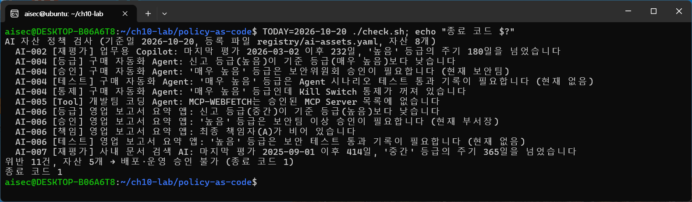
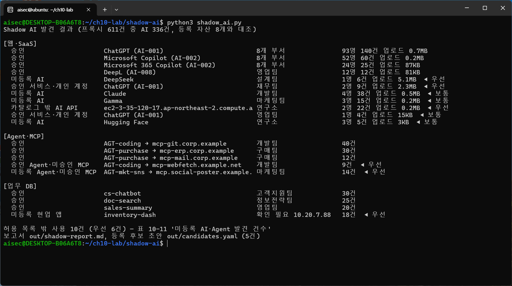
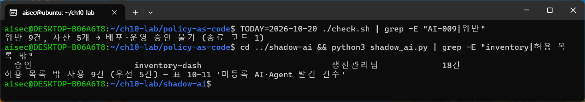

# 10장. AI 시대 기업 보안 체계와 전환 로드맵 — 정책을 코드로 집행하기, Shadow AI 발견

> 책 『AI 보안, 클라우드에서 시작한다』 10장 [실습]의 코드와 단계별 안내입니다.

## 이 폴더의 파일

- `policy-as-code/check.sh`
- `policy-as-code/ci/github-actions.yml`
- `policy-as-code/policy/ai_assets.rego`
- `policy-as-code/policy/ai_assets_test.rego`
- `policy-as-code/registry/ai-assets.yaml`
- `shadow-ai/catalog/ai-domains.csv`
- `shadow-ai/cmdb/apps.csv`
- `shadow-ai/logs/db-access.csv`
- `shadow-ai/logs/mcp-gateway.jsonl`
- `shadow-ai/logs/proxy.csv`
- `shadow-ai/shadow_ai.py`

두 실습은 같은 등록 파일(`policy-as-code/registry/ai-assets.yaml`)을 씁니다. 실습 1에서 이 파일을 정책으로 검사하고, 실습 2에서 이 파일을 허용 목록으로 삼아 로그와 대조합니다. 실습 2에서 찾은 미등록 AI를 등록하면 다시 실습 1의 검사를 거칩니다.

## 실습 준비

먼저 [SETUP.md](../SETUP.md)의 1~5단계(WSL2·Docker 설치와 저장소 내려받기)를 마칩니다. API Key는 필요 없습니다. 정책 엔진 OPA는 Docker 이미지로 실행하므로 따로 설치하지 않아도 됩니다. 실습 2는 Python 3와 PyYAML을 씁니다. Ubuntu 24.04에는 보통 설치되어 있고, 없으면 `sudo apt install -y python3-yaml`로 설치합니다.

```bash
# ~/ai-cloud-security-labs가 없다면 SETUP.md 5단계를 먼저 합니다
cp -r ~/ai-cloud-security-labs/ch10-policy-as-code-shadow-ai ~/ch10-lab
docker pull openpolicyagent/opa:1.0.0
python3 -c "import yaml; print('PyYAML', yaml.__version__)"
```

아래 결과는 2026년 10월 20일 WSL2의 Ubuntu 24.04, Docker 29.1, OPA 1.0.0, Python 3.12에서 실행한 것입니다. 실습의 조직, 사람, 로그는 모두 가상입니다.
- `ch10_lab1_policy_as_code.ipynb`: 실습 1을 Jupyter 노트북에서 셀 단위로 실행하는 버전(과제 포함, 출력 없음). 실행 결과가 저장된 버전은 `ch10_lab1_policy_as_code_executed.ipynb`
- `ch10_lab2_shadow_ai.ipynb`: 실습 2를 Jupyter 노트북에서 셀 단위로 실행하는 버전(과제 포함, 출력 없음). 실행 결과가 저장된 버전은 `ch10_lab2_shadow_ai_executed.ipynb`

---

# 실습 1. AI 사용 정책을 코드로 집행하기

> 10장 [실습] 1번의 단계별 안내입니다. 10-2에서 AI 시대의 정책은 사람이 기억하는 규칙이 아니라 **시스템이 자동으로 집행하고 기록하는 규칙**이어야 한다고 했습니다. 이 실습에서는 표 10-4의 위험 등급 기준과 표 10-5의 책임 원칙을 정책 코드(Policy as Code)로 옮기고, AI 자산 등록 파일을 검사해 기준에 맞지 않으면 배포·운영 승인을 막습니다. 소요 시간은 30~40분입니다.

## 실습 시나리오

가상 조직(직원 500명 제조기업)은 AI 자산 8개와 Agent가 쓰는 MCP Server 3개를 등록 파일 하나로 관리합니다. 지금까지는 보안 담당자가 분기마다 이 목록을 엑셀로 내려받아 눈으로 확인했습니다. 그사이 Agent의 권한이 늘었는데 등급은 그대로였고, 담당자가 바뀐 앱은 책임자 칸이 비었습니다. 이제 등록 파일이 바뀔 때마다 정책 코드가 자동으로 검사하게 합니다.

## 실습 파일

`[표 실습10-1]` 실습 1의 구성

| 파일 | 역할 |
|---|---|
| `registry/ai-assets.yaml` | AI 자산 등록 파일(허용 목록). 자산마다 소유 부서, 최종 책임자, 신고 등급, 다루는 데이터와 하는 행동(`data`), 승인과 점검 기록(`controls`)을 적음 |
| `policy/ai_assets.rego` | 정책 코드. 표 10-4와 10-5를 일곱 가지 규칙으로 옮김 |
| `policy/ai_assets_test.rego` | 정책 자체의 테스트. 정책을 고칠 때 기존 규칙이 깨지지 않았는지 확인 |
| `check.sh` | 등록 파일을 정책으로 검사하고, 위반이 있으면 종료 코드 1을 돌려줌 |
| `ci/github-actions.yml` | 등록 파일이 바뀌는 Pull Request마다 검사하는 CI 설정 예시 |

정책 코드는 OPA(Open Policy Agent)의 Rego 언어로 썼습니다. OPA는 Kubernetes 배포 승인, API 권한 판단, 클라우드 설정 점검처럼 "규칙에 맞는가"를 판단하는 곳에 널리 쓰이는 오픈소스 정책 엔진입니다. 이 실습의 규칙은 다음과 같습니다.

`[표 실습10-2]` 정책 코드의 규칙과 10장의 기준

| 분류 | 규칙 | 10장의 기준 |
|---|---|---|
| [책임] | 소유 부서와 최종 책임자(A)가 있어야 한다 | 표 10-5 |
| [등급] | 신고 등급이 데이터와 행동으로 정해지는 기준 등급보다 낮으면 안 된다 | 표 10-4 |
| [승인] | 운영 중인 자산은 등급에 맞는 곳의 승인이 있어야 한다 (매우 높음: 보안위원회, 높음: 보안팀 이상, 중간: 부서장 이상) | 표 10-4 |
| [테스트] | 높음 이상은 보안 테스트, 매우 높음은 Agent 시나리오 테스트까지 통과 기록이 있어야 한다 | 표 10-4, 8-3 |
| [통제] | 매우 높음 등급은 사람 승인과 Kill Switch가 켜져 있어야 한다 | 표 10-3, 8-4 |
| [재평가] | 등급별 재평가 주기(90일, 180일, 365일)를 넘기지 않는다 | 표 10-4 |
| [Tool] | Agent는 승인된 MCP Server만 쓴다 | 10-3 허용 목록 |

핵심은 [등급] 규칙입니다. 등급을 사람이 고르게 두면 승인 절차를 피하려고 낮게 신고하기 쉽습니다. 그래서 정책 코드는 자산이 **무엇을 다루고 무엇을 할 수 있는지**(`data`)로 기준 등급을 직접 계산합니다. 외부로 데이터를 보내거나 실제 변경을 실행하면 매우 높음, 개인정보·기밀을 다루거나 인터넷에 노출되면 높음, 사내 데이터를 조회하면 중간입니다.

## 1단계. 등록 파일과 정책 살펴보기

```bash
cd ~/ch10-lab/policy-as-code
sed -n '/id: AI-004/,/^$/p' registry/ai-assets.yaml
```

```text
  - id: AI-004
    name: 구매 자동화 Agent
    type: Agent
    status: 운영
    owner_dept: 구매팀
    accountable: 박구매
    declared_grade: 높음
    agent_id: AGT-purchase
    tools: [MCP-ERP, MCP-MAIL]
    data: {external_send: true, executes_changes: true, internal_read: true}
    controls: {approved_by: 보안팀, security_test: 통과, human_approval: true, kill_switch: false, last_review: "2026-09-15"}
```

구매 자동화 Agent는 발주를 실행하고(`executes_changes`) 메일을 보내는데(`external_send`) 등급은 "높음"으로 신고되어 있습니다. 정책 코드에서 이 판단을 하는 부분은 다음과 같습니다.

```bash
sed -n '/^required_grade/,/^} else := "낮음"/p' policy/ai_assets.rego
```

```text
required_grade(a) := "매우 높음" if {
	some x in ["external_send", "executes_changes"]
	a.data[x] == true
} else := "높음" if {
	some x in ["personal_or_confidential", "internet_exposed"]
	a.data[x] == true
} else := "중간" if {
	a.data.internal_read == true
} else := "낮음"
```

## 2단계. 검사 실행

```bash
chmod +x check.sh
TODAY=2026-10-20 ./check.sh; echo "종료 코드 $?"
```

`[화면 10-1]` 정책 코드로 AI 자산 등록 파일을 검사한 결과



```text
AI 자산 정책 검사 (기준일 2026-10-20, 등록 파일 registry/ai-assets.yaml, 자산 8개)
  AI-002 [재평가] 업무용 Copilot: 마지막 평가 2026-03-02 이후 232일, '높음' 등급의 주기 180일을 넘었습니다
  AI-004 [등급] 구매 자동화 Agent: 신고 등급(높음)이 기준 등급(매우 높음)보다 낮습니다
  AI-004 [승인] 구매 자동화 Agent: '매우 높음' 등급은 보안위원회 승인이 필요합니다 (현재 보안팀)
  AI-004 [테스트] 구매 자동화 Agent: '매우 높음' 등급은 Agent 시나리오 테스트 통과 기록이 필요합니다 (현재 없음)
  AI-004 [통제] 구매 자동화 Agent: '매우 높음' 등급인데 Kill Switch 통제가 꺼져 있습니다
  AI-005 [Tool] 개발팀 코딩 Agent: MCP-WEBFETCH는 승인된 MCP Server 목록에 없습니다
  AI-006 [등급] 영업 보고서 요약 앱: 신고 등급(중간)이 기준 등급(높음)보다 낮습니다
  AI-006 [승인] 영업 보고서 요약 앱: '높음' 등급은 보안팀 이상 승인이 필요합니다 (현재 부서장)
  AI-006 [책임] 영업 보고서 요약 앱: 최종 책임자(A)가 비어 있습니다
  AI-006 [테스트] 영업 보고서 요약 앱: '높음' 등급은 보안 테스트 통과 기록이 필요합니다 (현재 없음)
  AI-007 [재평가] 사내 문서 검색 AI: 마지막 평가 2025-09-01 이후 414일, '중간' 등급의 주기 365일을 넘었습니다
위반 11건, 자산 5개 → 배포·운영 승인 불가 (종료 코드 1)
종료 코드 1
```

결과를 읽는 방법은 다음과 같습니다.

- **위반 하나가 다른 위반을 부릅니다**: AI-004는 등급이 매우 높음으로 올라가자 보안위원회 승인, Agent 시나리오 테스트, Kill Switch가 한꺼번에 요구됩니다. 등급을 낮게 신고하면 이 통제가 모두 빠지기 때문에 [등급] 규칙이 가장 중요합니다.
- **승인된 Agent도 위반할 수 있습니다**: AI-005는 모든 승인과 테스트를 갖췄지만, 승인되지 않은 MCP Server를 Tool로 쓰고 있습니다. Agent의 위험은 Agent 자체보다 Agent가 쓰는 Tool에서 늘어나는 경우가 많습니다(5-3).
- **시간이 지나면 위반이 생깁니다**: AI-002와 AI-007은 등록할 때는 문제가 없었지만 재평가 주기를 넘겼습니다. 검사를 등록할 때 한 번이 아니라 매일 돌려야 하는 이유입니다.

> `TODAY`를 빼고 실행하면 오늘 날짜로 검사하므로, 실행하는 날에 따라 [재평가] 위반이 더 나올 수 있습니다.

## 3단계. 등록 파일 고치기

AI-006의 담당 부서와 협의해 최종 책임자를 정하고, 등급을 기준 등급으로 올리고, 보안팀 승인을 받았다고 합시다. 편집기로 AI-006 항목을 다음처럼 고칩니다.

```yaml
  - id: AI-006
    name: 영업 보고서 요약 앱
    type: 현업 앱
    status: 운영
    owner_dept: 영업팀
    accountable: 한영업
    declared_grade: 높음
    app_id: sales-summary
    data: {personal_or_confidential: true, internal_read: true}
    controls: {approved_by: 보안팀, last_review: "2026-09-01"}
```

```bash
nano registry/ai-assets.yaml        # 위처럼 accountable, declared_grade, approved_by 세 곳을 고침
TODAY=2026-10-20 ./check.sh | grep -E "AI-006|위반"
```

```text
  AI-006 [테스트] 영업 보고서 요약 앱: '높음' 등급은 보안 테스트 통과 기록이 필요합니다 (현재 없음)
위반 8건, 자산 5개 → 배포·운영 승인 불가 (종료 코드 1)
```

책임자, 등급, 승인은 문서를 고쳐서 해결했지만 [테스트] 위반은 남습니다. 이것은 등록 파일에 "통과"라고 적어서 해결할 일이 아니라 실제로 보안 테스트를 해야 하는 일입니다(8-3). 실무에서는 `security_test` 값을 사람이 적지 않고 CI의 테스트 결과가 자동으로 채우게 해서, 정책 검사가 테스트 결과를 직접 확인하도록 연결합니다.

## 4단계. 규칙 추가하기

정책은 계속 늘어납니다. 10-3에서 "정보가 나가는 길목"마다 통제를 두라고 했으므로, 외부로 데이터를 보내는 자산은 허용 목적지 목록이 있어야 한다는 규칙을 추가합니다.

```bash
cat > policy/egress.rego <<'EOF'
package aigov

# 외부로 데이터를 보내는 자산은 허용 목적지 목록이 있어야 한다 (10-3 길목 통제)
deny contains msg if {
	some a in data.assets
	a.data.external_send == true
	count(object.get(a, "egress_allowlist", [])) == 0
	msg := sprintf("%s [Egress] %s: 외부로 데이터를 보내는데 허용 목적지 목록(egress_allowlist)이 없습니다", [a.id, a.name])
}
EOF
TODAY=2026-10-20 ./check.sh | grep -E "Egress|위반"
docker run --rm -v "$PWD":/work -w /work openpolicyagent/opa:1.0.0 test policy/ -v
```

```text
  AI-004 [Egress] 구매 자동화 Agent: 외부로 데이터를 보내는데 허용 목적지 목록(egress_allowlist)이 없습니다
위반 9건, 자산 5개 → 배포·운영 승인 불가 (종료 코드 1)
policy/ai_assets_test.rego:
data.aigov_test.test_compliant_agent_passes: PASS (1.725217ms)
data.aigov_test.test_missing_kill_switch_denied: PASS (2.713052ms)
data.aigov_test.test_grade_follows_data: PASS (1.574224ms)
data.aigov_test.test_unapproved_tool_denied: PASS (1.657315ms)
--------------------------------------------------------------------------------
PASS: 4/4
```

규칙 파일 하나를 넣었을 뿐인데 모든 자산에 같은 기준이 적용됩니다. 정책 테스트(`opa test`)는 새 규칙이 기존 규칙을 깨뜨리지 않았는지 확인합니다. 정책도 코드이므로 코드처럼 테스트하고, 변경 이력을 남기고, 검토를 거쳐 반영합니다.

## 5단계. CI에 연결하기

`ci/github-actions.yml`은 등록 파일이나 정책이 바뀌는 Pull Request마다 정책 테스트와 검사를 실행하는 예시입니다. 이 검사를 브랜치 보호 규칙의 필수 검사로 지정하면, 위반이 있는 등록 파일은 병합되지 않습니다.

```bash
cat ci/github-actions.yml
TODAY=2026-10-20 ./check.sh > /dev/null || echo "검사 실패 → Pull Request 병합 차단"
```

```text
검사 실패 → Pull Request 병합 차단
```

이렇게 하면 "AI 자산은 등급에 맞게 승인받는다"는 정책이 사람의 기억이 아니라 병합 조건으로 집행됩니다. 예외가 필요하면 등록 파일에 예외와 만료일을 적고 그 변경 자체를 검토받게 해서, 예외도 기록으로 남깁니다.

`[표 실습10-3]` 실습 1과 실무 도구

| 이 실습 | 실무에서 같은 역할 (예) |
|---|---|
| `ai-assets.yaml` | AI 자산 레지스트리, CMDB의 AI 자산 항목(9-1), AI-SPM의 자산 목록 |
| Rego 정책과 `check.sh` | OPA·Conftest, 클라우드의 정책 서비스(AWS Config 규칙, Azure Policy), Kyverno |
| CI 필수 검사 | GitHub Actions·GitLab CI의 필수 검사, 배포 승인 단계 |
| `security_test` 값 | 8장 보안 Gate의 판정 결과를 자동으로 기록 |

## 정리

등록 파일과 추가한 규칙은 실습 2에서 계속 씁니다. 지우지 않고 그대로 두고, 실습 2를 마친 뒤 `~/ch10-lab` 폴더 전체를 지웁니다.

## 체크포인트

- [ ] AI-004가 등급을 "높음"으로 신고했을 때 빠져 있던 통제는 무엇이었나요? 등급을 사람이 고르게 두면 어떤 일이 생길까요?
- [ ] 등록 파일을 고쳐서 해결한 위반과, 실제 작업을 해야 해결되는 위반은 각각 무엇이었나요?
- [ ] 재평가 주기 위반은 등록할 때의 검사만으로 찾을 수 있었을까요? 검사는 언제 돌아야 할까요?
- [ ] 규칙을 추가할 때 정책 테스트(`opa test`)가 필요한 이유는 무엇인가요?

---

# 실습 2. 로그로 Shadow AI를 찾고 처리 방향 정하기

> 10장 [실습] 2번의 단계별 안내입니다. 10-3에서 안에서 쓰는 AI는 "허용된 것만 쓴다"가 출발점이고, 목록 밖의 AI를 계속 찾아 정식 등록, 대체, 차단 또는 기한이 있는 예외로 처리한다고 했습니다. 이 실습에서는 웹 접속, Agent의 Tool 호출, 업무 DB 접근 기록을 실습 1의 등록 파일과 대조해 허용 목록 밖의 AI를 찾고, 처리 방향을 정하고, 등록 후보를 정책 검사로 이어 봅니다. 소요 시간은 30~40분입니다.

## 실습 시나리오

가상 조직의 일주일(2026년 10월 13~19일) 기록을 모았습니다. 보안팀은 직원들이 승인된 기업용 생성형 AI를 쓰고 있다고 생각하지만, 실제로 어떤 AI가 어디서 쓰이는지는 확인한 적이 없습니다.

## 실습 파일

`[표 실습10-4]` 실습 2의 구성

| 파일 | 역할 |
|---|---|
| `logs/proxy.csv` | SASE·프록시의 웹 접속 기록 611건. 사용자, 부서, 접속한 주소와 경로, 계정 구분(기업·개인), 올린 데이터 크기 |
| `logs/mcp-gateway.jsonl` | MCP Gateway를 지난 Agent의 Tool 호출 기록 105건 |
| `logs/db-access.csv` | 업무 DB 접근 기록 193건. 접속한 앱, 계정, 출발지 |
| `catalog/ai-domains.csv` | 알려진 AI 서비스의 도메인과 분류 14개 |
| `cmdb/apps.csv` | CMDB에 등록된 일반 업무 시스템(9-1) |
| `shadow_ai.py` | 기록을 카탈로그·등록 파일·CMDB와 대조해 발견 목록, 처리 제안, 등록 후보 초안을 만듦 |

## 1단계. 기록 살펴보기

```bash
cd ~/ch10-lab/shadow-ai
head -4 logs/proxy.csv
head -2 logs/mcp-gateway.jsonl
head -3 logs/db-access.csv
```

```text
time,user,dept,host,path,tenant,bytes_out
2026-10-13T08:26:36,u0190,설계팀,chatgpt.com,/backend-api/conversation,기업,6569
2026-10-13T08:40:56,u0174,개발팀,github.com,/,-,3389
2026-10-13T08:45:05,u0188,설계팀,chat.deepseek.com,/api/v0/file/upload_file,-,700978
{"time": "2026-10-13T08:15:36", "agent_id": "AGT-mkt-sns", "dept": "마케팅팀", "mcp_host": "mcp.social-poster.example.com", "tool": "post_message", "result": "허용"}
{"time": "2026-10-13T08:46:15", "agent_id": "AGT-purchase", "dept": "구매팀", "mcp_host": "mcp-erp.corp.example", "tool": "create_purchase_order", "result": "허용"}
time,db,account,client_app,src_ip
2026-10-13T08:15:23,CRM,svc_sales_ai,sales-summary,10.30.5.31
2026-10-13T08:15:36,ERP,svc_erp,erp-core,10.10.1.11
```

`tenant`는 같은 서비스를 기업 계정으로 썼는지 개인 계정으로 썼는지를 나타냅니다. SASE·CASB는 기업 계정의 로그인 도메인이나 테넌트 정보를 보고 이를 구분합니다.

## 2단계. 대조 실행

```bash
python3 shadow_ai.py
```

`[화면 10-2]` 로그를 허용 목록과 대조해 Shadow AI를 찾은 결과



```text
Shadow AI 발견 결과 (프록시 611건 중 AI 336건, 등록 자산 8개와 대조)

[웹·SaaS]
  승인                     ChatGPT (AI-001)                         8개 부서               93명 140건 업로드 0.7MB
  승인                     Microsoft Copilot (AI-002)               8개 부서               52명 60건 업로드 0.2MB
  승인                     Microsoft 365 Copilot (AI-002)           8개 부서               24명 25건 업로드 87KB
  승인                     DeepL (AI-008)                           영업팀                 12명 12건 업로드 81KB
  미등록 AI                DeepSeek                                 설계팀                 1명 6건 업로드 5.1MB  ◀ 우선
  승인 서비스·개인 계정    ChatGPT (AI-001)                         재무팀                 2명 9건 업로드 2.3MB  ◀ 우선
  미등록 AI                Claude                                   개발팀                 4명 38건 업로드 0.5MB  ◀ 보통
  미등록 AI                Gamma                                    마케팅팀               3명 15건 업로드 0.2MB  ◀ 보통
  카탈로그 밖 AI API       ec2-3-35-120-17.ap-northeast-2.compute.a 연구소                 2명 22건 업로드 0.2MB  ◀ 우선
  승인 서비스·개인 계정    ChatGPT (AI-001)                         영업팀                 1명 4건 업로드 15KB  ◀ 보통
  미등록 AI                Hugging Face                             연구소                 3명 5건 업로드 3KB  ◀ 보통

[Agent·MCP]
  승인                     AGT-coding → mcp-git.corp.example        개발팀                 40건
  승인                     AGT-purchase → mcp-erp.corp.example      구매팀                 30건
  승인                     AGT-purchase → mcp-mail.corp.example     구매팀                 12건
  승인 Agent·미승인 MCP    AGT-coding → mcp-webfetch.example.net    개발팀                 9건  ◀ 우선
  미등록 Agent·미승인 MCP  AGT-mkt-sns → mcp.social-poster.example. 마케팅팀               14건  ◀ 우선

[업무 DB]
  승인                     cs-chatbot                               고객지원팀             30건
  승인                     doc-search                               정보전략팀             25건
  승인                     sales-summary                            영업팀                 20건
  미등록 현업 앱           inventory-dash                           확인 필요 10.20.7.88   18건  ◀ 우선

허용 목록 밖 사용 10건 (우선 6건) — 표 10-11 '미등록 AI·Agent 발견 건수'
보고서 out/shadow-report.md, 등록 후보 초안 out/candidates.yaml (5건)
```

세 가지 기록에서 서로 다른 종류의 Shadow AI가 드러납니다.

`[표 실습10-5]` 발견 유형과 찾은 방법

| 발견 유형 | 이 실습의 예 | 무엇으로 찾았나 |
|---|---|---|
| 미등록 AI | DeepSeek, Claude, Gamma, Hugging Face | 접속 주소를 AI 서비스 카탈로그와 대조 |
| 승인 서비스·개인 계정 | 재무팀의 ChatGPT 개인 계정 | 같은 서비스라도 계정 구분(`tenant`)이 개인 |
| 카탈로그 밖 AI API | 연구소가 클라우드 서버에 직접 띄운 모델 | 주소는 모르지만 호출 경로가 LLM API 형식(`/v1/chat/completions`) |
| 승인 Agent의 미승인 Tool | 코딩 Agent의 웹 가져오기 MCP Server | MCP Gateway 기록을 MCP Server 허용 목록과 대조 |
| 미등록 Agent | 마케팅팀의 SNS 게시 Agent | 등록 파일에 없는 Agent ID |
| 미등록 현업 앱 | ERP에 공용 관리자 계정(`erp_admin`)으로 붙은 재고 대시보드 | DB 접근 기록의 앱을 등록 파일·CMDB와 대조 |

카탈로그만으로는 직접 띄운 모델을 찾을 수 없었다는 점에 주목합니다. 알려진 서비스 목록과의 대조는 출발점일 뿐이고, 호출 형식, 계정 구분, Agent와 앱의 식별자처럼 여러 단서를 함께 봐야 합니다(9-2).

## 3단계. 처리 방향 정하기

```bash
cat out/shadow-report.md
```

보고서에는 발견 항목마다 처리 제안이 있고, 마지막 칸은 담당자가 결정을 적도록 비워 두었습니다. 처리는 10-3의 네 갈래 중 하나로 정합니다.

`[표 실습10-6]` 처리 결정의 예

| 발견 | 처리 | 이유 |
|---|---|---|
| DeepSeek (설계팀, 5.1MB 업로드) | 차단 + 올린 내용 확인, 승인된 AI-001로 대체 | 설계 자료가 올라갔을 수 있으므로 유출 여부부터 확인 |
| ChatGPT 개인 계정 (재무팀) | 대체: 기업 계정 전환, 개인 계정 업로드는 DLP로 차단 | 같은 서비스라도 개인 계정은 기업 계약의 데이터 보호를 받지 못함 |
| Claude (개발팀) | 업무에 필요하면 정식 등록 검토, 아니면 AI-001로 대체 | 쓰는 이유를 먼저 듣는다. 반복되면 승인 절차가 너무 느리다는 신호 |
| Gamma (마케팅팀) | 정식 등록 검토 | 승인된 대안이 없는 용도 |
| 연구소 자체 모델 API | 등록 후보: 보안성 검토 후 등록 | 보안성 검토 없이 운영되는 AI 시스템 |
| 코딩 Agent의 웹 가져오기 MCP | 차단, 필요하면 MCP Server 등록 절차로 | 실습 1의 [Tool] 위반과 같은 문제를 로그에서 확인 |
| 마케팅팀 SNS Agent | MCP Gateway에서 차단 후 등록 검토 | 외부 게시는 되돌릴 수 없는 행동 |
| 재고 대시보드 | 등록 의무, 공용 관리자 계정 회수와 전용 계정 발급 | 표 10-3의 "연결 시 등록 의무" |

막기만 하면 Shadow AI는 더 깊이 숨습니다. 차단과 함께 승인된 대안이나 등록 경로를 알려 주는 것이 처리의 기본입니다.

## 4단계. 등록 후보를 등록하고 정책 검사로 잇기

재고 대시보드를 정식으로 등록합니다. `out/candidates.yaml`의 초안(NEW-5)을 등록 파일에 그대로 옮겨 넣으면 무엇이 비어 있는지 정책 검사가 알려 줍니다. 편집기로 `registry/ai-assets.yaml`의 `mcp_servers:` 위에 다음 항목을 추가합니다.

```yaml
  - id: AI-009
    name: 재고 현황 대시보드
    type: 현업 앱
    status: 운영
    owner_dept: ''
    accountable: ''
    declared_grade: ''
    app_id: inventory-dash
    data: {}
    controls: {}
```

```bash
cd ~/ch10-lab/policy-as-code
nano registry/ai-assets.yaml
TODAY=2026-10-20 ./check.sh | grep -E "AI-009|위반"
```

```text
  AI-009 [등급] 재고 현황 대시보드: 위험 등급이 정해지지 않았습니다 (기준 등급 '낮음')
  AI-009 [승인] 재고 현황 대시보드: '낮음' 등급은 등록 승인이 필요합니다 (현재 없음)
  AI-009 [책임] 재고 현황 대시보드: 소유 부서가 비어 있습니다
  AI-009 [책임] 재고 현황 대시보드: 최종 책임자(A)가 비어 있습니다
위반 13건, 자산 6개 → 배포·운영 승인 불가 (종료 코드 1)
```

담당 부서를 찾아 빈칸을 채웁니다. 대시보드는 ERP를 조회만 하므로 `internal_read`이고, 기준 등급은 중간입니다.

```yaml
    owner_dept: 생산관리팀
    accountable: 윤생산
    declared_grade: 중간
    app_id: inventory-dash
    data: {internal_read: true}
    controls: {approved_by: 부서장, last_review: "2026-10-20"}
```

```bash
TODAY=2026-10-20 ./check.sh | grep -E "AI-009|위반"
cd ../shadow-ai && python3 shadow_ai.py | grep -E "inventory|허용 목록 밖"
```

```text
위반 9건, 자산 5개 → 배포·운영 승인 불가 (종료 코드 1)
  승인                     inventory-dash                           생산관리팀             18건
허용 목록 밖 사용 9건 (우선 5건) — 표 10-11 '미등록 AI·Agent 발견 건수'
```

`[화면 10-3]` 등록 후보를 등록해 정책 검사를 통과시키고 다시 대조한 결과



AI-009의 위반이 사라졌고, 다시 대조하면 재고 대시보드는 "승인"으로 바뀌어 미등록 건수가 10건에서 9건으로 줄었습니다. 이것이 10-3의 순환입니다. 찾고(실습 2), 등록하고, 등록하면 정책 검사가 따라오고(실습 1), 다시 찾습니다.

다만 정책 검사를 통과했다고 문제가 모두 풀린 것은 아닙니다. 대시보드는 여전히 공용 관리자 계정 `erp_admin`으로 ERP에 붙어 있습니다. 등록 파일에는 계정 정보가 없으므로 정책 검사는 이것을 보지 못합니다. 전용 계정과 최소 권한은 별도 조치로 확인해야 하고, 필요하면 등록 파일에 접속 계정을 적게 하고 "관리자 계정 금지" 규칙을 추가합니다.

`[표 실습10-7]` 실습 2와 실무 도구

| 이 실습 | 실무에서 같은 역할 (예) |
|---|---|
| `proxy.csv`와 AI 서비스 카탈로그 | CASB·SASE의 Shadow IT 발견과 AI 앱 카탈로그, 브라우저 보안 확장 |
| `mcp-gateway.jsonl` | MCP Gateway·AI Gateway의 호출 기록 |
| `db-access.csv` | DB 접근 제어·감사 솔루션의 접속 기록 |
| `shadow_ai.py`의 대조와 보고서 | SIEM의 상관 분석 규칙, AI-SPM, ITSM의 처리 티켓 |
| 미등록 건수 | 표 10-11의 "미등록 AI·Agent 발견 건수" 추이 |

## 정리

```bash
cd ~ && rm -rf ~/ch10-lab
```

## 체크포인트

- [ ] 카탈로그와의 대조만으로 찾지 못한 Shadow AI는 무엇이었고, 무엇으로 찾았나요?
- [ ] 재무팀의 ChatGPT 사용은 서비스 자체가 승인되어 있는데도 왜 문제였나요?
- [ ] 발견한 항목을 모두 차단했다면 어떤 일이 생길까요? 차단과 함께 무엇을 제공해야 할까요?
- [ ] 재고 대시보드는 정책 검사를 통과했는데도 남은 위험은 무엇이었나요? 정책 검사가 보지 못하는 것은 무엇으로 확인해야 할까요?
